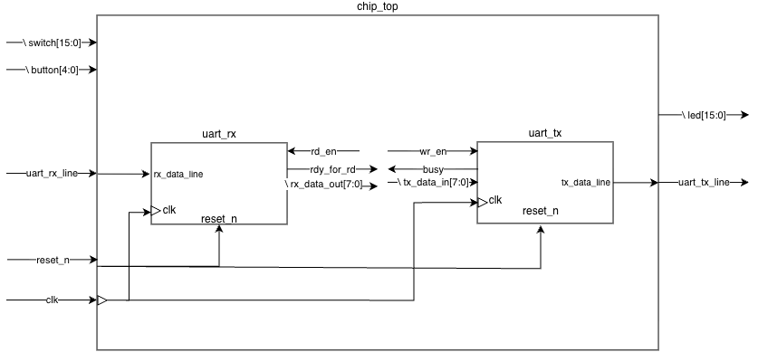

# Lab 1 – UART stub: top-down hierarchical design

First lab: set up Vivado and practice the **top-down** methodology that the rest of the course project
(a small SoC core with a UART interface) will follow. Nothing is implemented yet; the goal is to get the
architecture, the interfaces and the hierarchy right *before* writing any micro-architecture.

## What was done

1. **Block diagram of the SoC** – `chip_top` with its board-level I/O (switches, push-buttons, LEDs,
   UART RX/TX, clock and reset) and the two UART blocks inside it.
2. **I/O table per block** – port name, direction, type and description (below).
3. **Module stubs** – `chip_top.sv`, `uart_rx.sv`, `uart_tx.sv` with the ports declared and no logic,
   one module per file, file named after the module.
4. **Integration** – both UARTs instantiated in `chip_top` with named port connections.
5. **Lint** – every module linted individually and after integration, clean.
6. **Cross-check** against the RTL schematic Vivado generates from the elaborated design
   (`docs/vivado_rtl_schematic.pdf`) – it matches my block diagram.

Submitted report (Hebrew): [`docs/lab1_report.pdf`](docs/lab1_report.pdf).



## Interfaces

**`chip_top`**

| Port | Dir | Width | Description |
|---|---|---|---|
| `clk` | in | 1 | board clock |
| `reset_n` | in | 1 | asynchronous reset, active low |
| `switch` | in | 16 | board slide switches |
| `button` | in | 5 | board push-buttons |
| `uart_rx_line` | in | 1 | serial line into the chip |
| `uart_tx_line` | out | 1 | serial line out of the chip |
| `led` | out | 16 | board LEDs |

**`uart_rx`** – serial in, parallel out with a ready/read-enable handshake

| Port | Dir | Width | Description |
|---|---|---|---|
| `clk`, `reset_n` | in | 1 | clock and active-low reset from `chip_top` |
| `rx_data_line` | in | 1 | serial data in |
| `rd_en` | in | 1 | consumer is ready to take a new word |
| `rdy_for_rd` | out | 1 | a received word is ready |
| `rx_data_out` | out | 8 | received byte |

**`uart_tx`** – parallel in, serial out with a write-enable/busy handshake

| Port | Dir | Width | Description |
|---|---|---|---|
| `clk`, `reset_n` | in | 1 | clock and active-low reset from `chip_top` |
| `tx_data_in` | in | 8 | byte to transmit |
| `wr_en` | in | 1 | `tx_data_in` is valid, start transmitting |
| `busy` | out | 1 | transmitter cannot accept a new byte yet |
| `tx_data_line` | out | 1 | serial data out |

The RX and TX blocks are intentionally **not** connected to each other: the FSM that decides when to
transmit, what to write and what to put on the lines comes in a later stage of the project.

## Files

```
rtl/chip_top.sv  rtl/uart_rx.sv  rtl/uart_tx.sv   the stubs
constraints/nexys_a7_100t.xdc                      clock, switches, LEDs and UART pins enabled
docs/chip_top.png                                  my block diagram
docs/chip_top_soc.png                              the same diagram with unconnected (NC) handshake pins marked
docs/vivado_rtl_schematic.pdf                      Vivado's auto-generated schematic for the cross-check
docs/lab1_report.pdf                               submitted lab report
```
