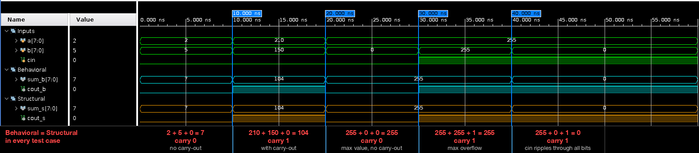
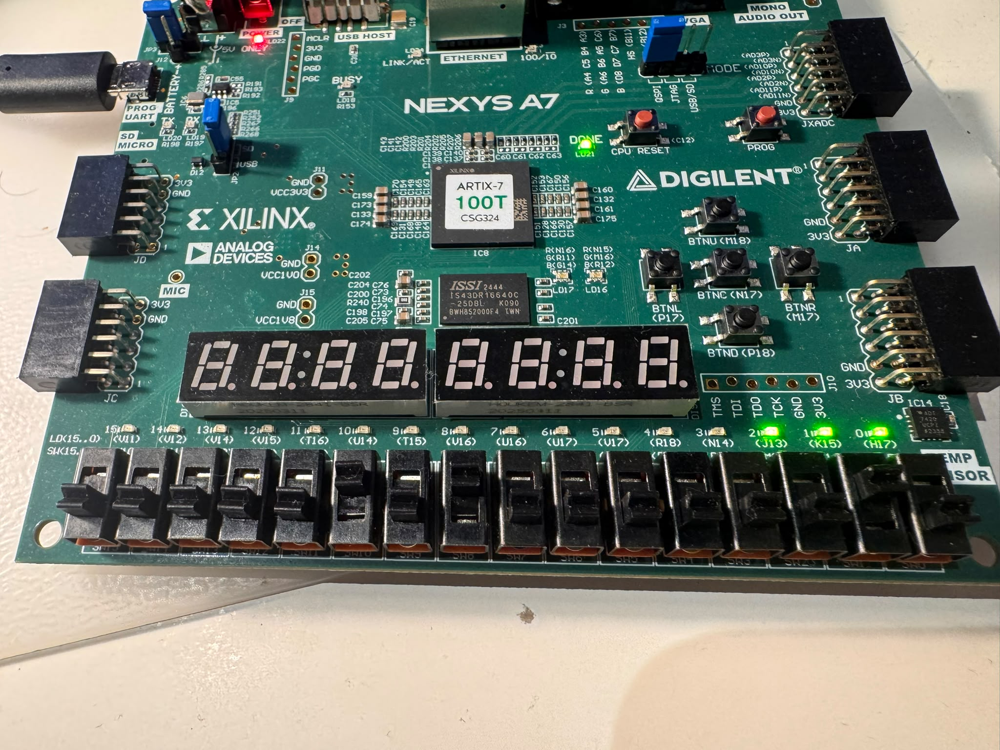
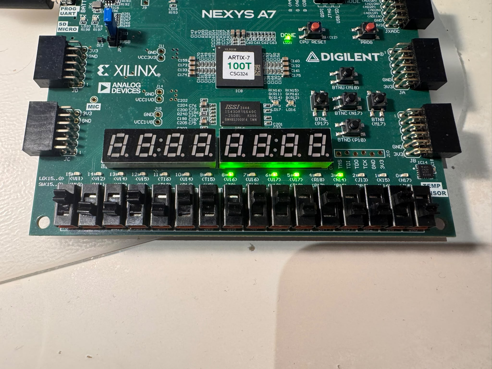
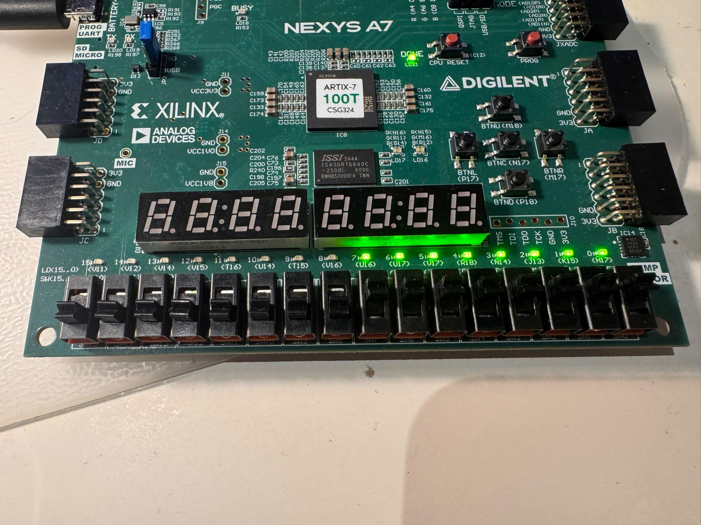

# Lab 2 – 8-bit adder: behavioral vs. flat structural

The same 8-bit adder with carry-in and carry-out written twice, simulated side by side in one
testbench, and one of them taken through synthesis, implementation and a board test.

| Implementation | File | Style |
|---|---|---|
| Behavioral | [`rtl/fa_8_behavioral.v`](rtl/fa_8_behavioral.v) | one line: `{cout, sum} = a + b + cin`, the tool builds the adder |
| Flat structural | [`rtl/fa_8_structural_flat.v`](rtl/fa_8_structural_flat.v) | ripple-carry adder: per-bit `sum = a ^ b ^ c`, `c[i+1] = c[i]&(a^b) \| a&b`, unrolled with `generate` |

```verilog
// structural: one full adder per bit, carry rippling through carry[8:0]
generate
    for (i = 0; i < 8; i = i + 1) begin : ripple_adder
        assign sum[i]     = a[i] ^ b[i] ^ carry[i];
        assign carry[i+1] = carry[i] & (a[i] ^ b[i]) | a[i] & b[i];
    end
endgenerate
```

## Simulation

[`tb/tb_fa_8.v`](tb/tb_fa_8.v) instantiates both adders, drives the same inputs into both and prints
them with `$monitor` in the format the lab asks for. Full log: [`sim/tb_fa_8_xsim.log`](sim/tb_fa_8_xsim.log).

| Case | a | b | cin | sum | cout |
|---|---|---|---|---|---|
| no carry-out | 2 | 5 | 0 | 7 | 0 |
| carry-out | 210 | 150 | 0 | 104 | 1 |
| max value, no carry-out | 255 | 0 | 0 | 255 | 0 |
| max overflow | 255 | 255 | 1 | 255 | 1 |
| carry ripples through every bit | 255 | 0 | 1 | 0 | 1 |

Both implementations agree on every case. [`tb/tb_fa_8_behavioral.v`](tb/tb_fa_8_behavioral.v) is an
exhaustive sweep of all 255×255×2 input combinations of the behavioral adder.



## Synthesis, implementation, board

`chip_top` instantiates the **structural** adder: `SW[7:0]` is `a`, `SW[15:8]` is `b`, the center
button is `cin`, `LED[7:0]` is the sum and `LED[8]` the carry-out. The design is purely combinational,
so the `.xdc` adds a virtual clock and a `set_max_delay` from every switch to every LED instead of a real
clock constraint.

* Lint: clean (`reports/lint_report.txt`), synthesis and implementation: no warnings.
* Resources after placement: 11 LUTs, 0 flip-flops, 25 I/O (`reports/impl_utilization_placed.rpt`).
  Vivado maps the ripple carry onto the slice carry chain, so the structural and behavioral netlists
  end up almost identical – compare `schematics/synth_fa_8_structural_flat.png` with
  `schematics/synth_fa_8_behavioral.png`. The RTL schematics (`schematics/rtl_*.png`) show the
  difference in the source: 8 explicit XOR/AND/OR cells vs. one `+` operator.
* Board test on the Nexys A7-100T, three of the simulation cases re-done on the switches:

| | | |
|---|---|---|
|  |  |  |
| 2 + 5 = 7, cout 0 | 210 + 150 = 104, cout 1 | 255 + 0 = 255, cout 0 |

## Behavioral vs. structural – takeaways

* **Behavioral** is shorter, harder to get wrong, and lets the tool pick the best adder for the target
  (here: the Artix-7 CARRY4 chain). Bit-widths still have to be right: the `{1'b0, a}` zero-extension is
  what makes the 9th bit of the sum land in `cout`.
* **Structural** makes the hardware explicit – the carry chain, the critical path from `cin` to
  `cout` – and is the form you need when the architecture *is* the point (a carry-lookahead or a
  pipelined adder would start from here).
* For the same function and the same tool, both synthesize to the same thing. The abstraction level is a
  design-time choice, not a resource one.

## Files

```
rtl/        fa_8_behavioral.v  fa_8_structural_flat.v  chip_top.v
tb/         tb_fa_8.v (shared, 5 cases)  tb_fa_8_behavioral.v (exhaustive)
sim/        xsim log + waveform screenshot
constraints/nexys_a7_100t.xdc           SW, LED, BTNC + max-delay constraints
reports/    lint, synthesis and implementation reports (DRC, methodology, timing, power, utilization, route status)
schematics/ RTL and post-synthesis schematics of both adders and chip_top (png + pdf)
docs/       block diagram
board_test/ photos
```
