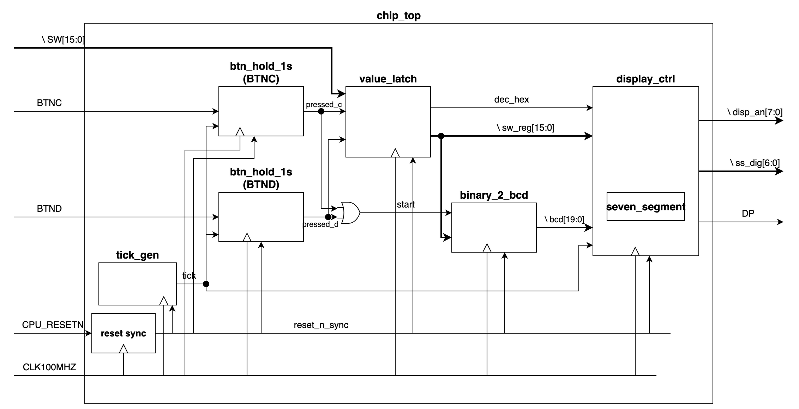
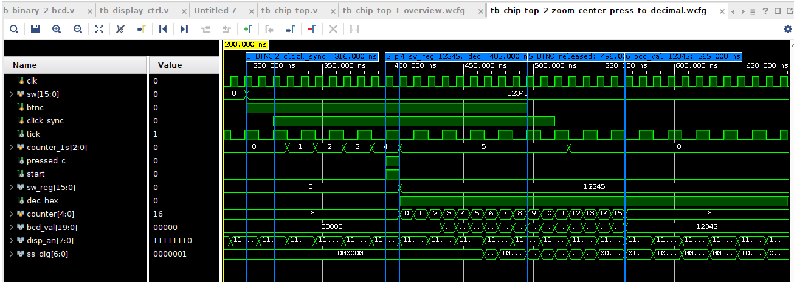
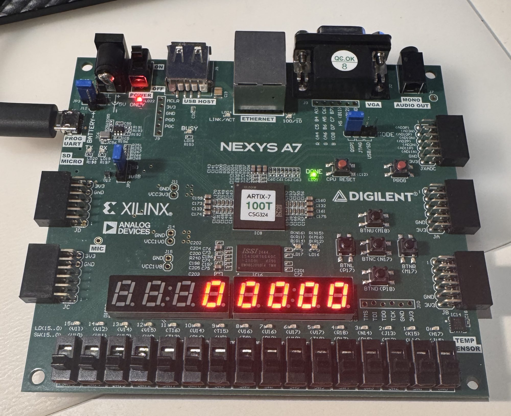
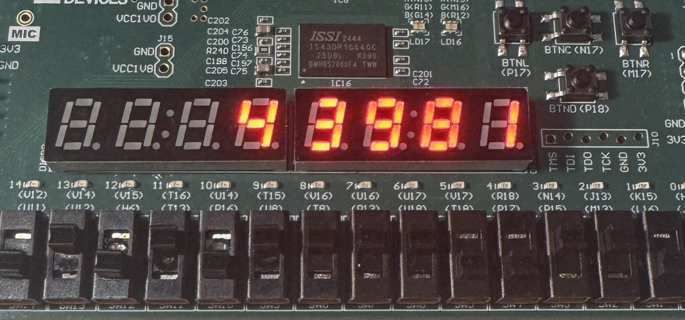
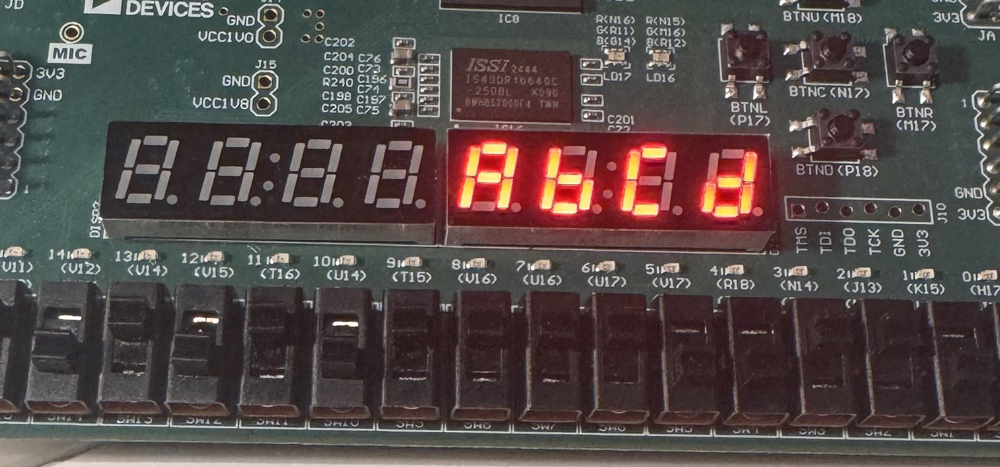
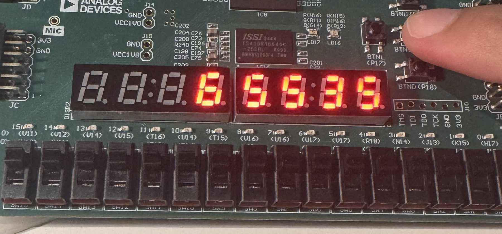
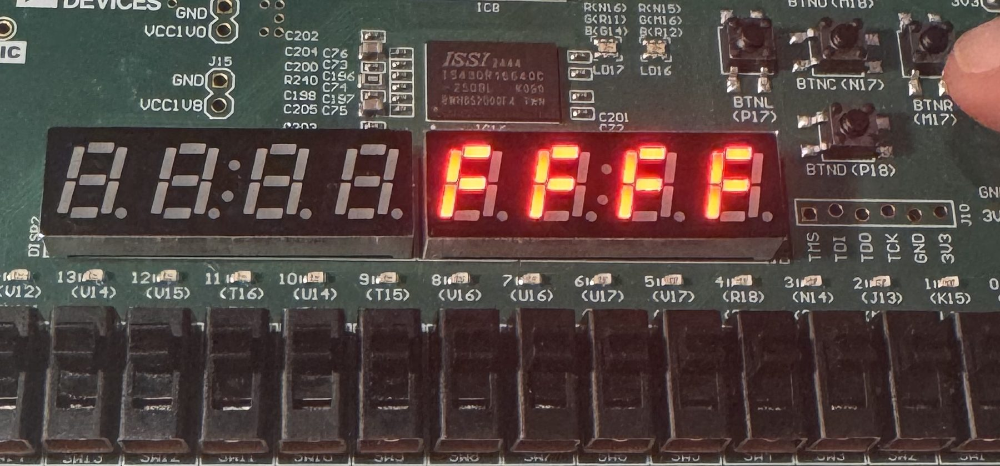
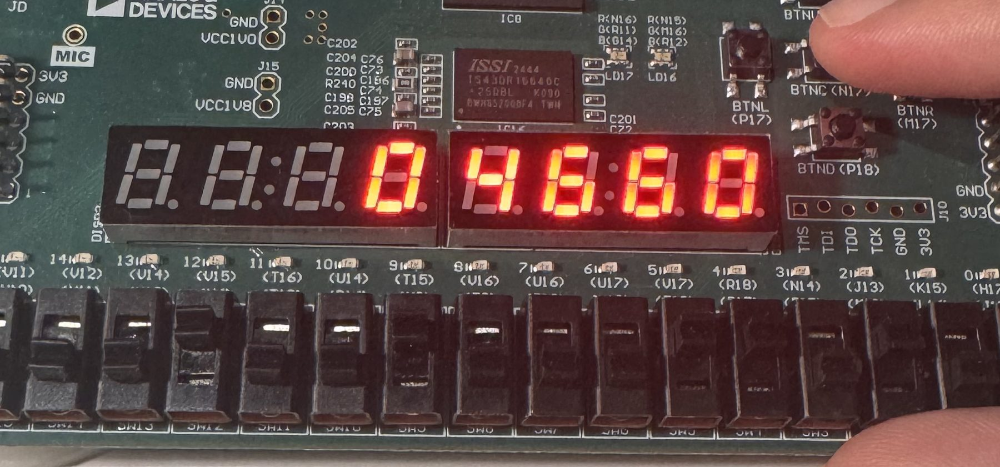

# Lab 3 – 7-segment display controller

A 16-bit value set on the switches is latched by holding the **center** (decimal) or **down** (hex)
push-button for one second, and shown on the Nexys A7's 8-digit 7-segment display without flicker.
`CPU_RESETN` clears the stored value. Fully verified in simulation (7 self-checking testbenches,
798 checks), lint-clean, synthesized, placed, routed and tested on the board.



## Architecture

One 100 MHz clock domain. There is no divided clock: `tick_gen` produces a **one-cycle enable** every
50 000 clocks (2 kHz) and everything slow runs off that tick, which keeps the design on a single clock
tree and out of CDC trouble. The 2 kHz tick scans five digits, so each digit refreshes at 400 Hz – the
lab's no-flicker target. A "1 second" press is simply 2000 of those ticks, so no separate 1 Hz divider
(and its 27-bit counter) is needed.

| Module | Function | Registers |
|---|---|---|
| [`chip_top`](rtl/chip_top.v) | 2-FF synchronizer for `CPU_RESETN`, instantiates everything, `start = pressed_c \| pressed_d` | 2 |
| [`tick_gen`](rtl/tick_gen.v) | 100 MHz → one-clock tick every `MAX_TICK` cycles (2 kHz) | 16 |
| [`btn_hold_1s`](rtl/btn_hold_1s.v) ×2 | 2-FF synchronizer on the raw button, counts ticks while held, one pulse when the count reaches `MAX_COUNT`; releasing early resets the count, bounces are ignored | 13 each |
| [`value_latch`](rtl/value_latch.v) | latches `SW` on a pulse, stores the mode (`dec_hex`); down wins if both are pressed | 17 |
| [`binary_2_bcd`](rtl/binary_2_bcd.v) | serial **double-dabble** 16-bit binary → 5 BCD digits, one bit per clock, 16 clocks | 25 |
| [`display_ctrl`](rtl/display_ctrl.v) | 5-bit one-hot anode ring advanced by the tick, nibble select, 5th digit enabled only in decimal mode, `DP` off | 5 |
| [`seven_segment`](rtl/seven_segment.v) | hex digit → 7 active-low cathodes | 0 |

Parameters make the slow timing simulable: the lab asks for a ~100 ns button hold in simulation.

| Parameter | Hardware | `tb_chip_top` | Meaning |
|---|---|---|---|
| `MAX_TICK` | 50 000 | 2 | clocks per tick (2 kHz) |
| `MAX_COUNT` | 2000 | 5 | ticks per "1 second" press |

Design notes that came up while doing it:

* Buttons are asynchronous inputs, so every one of them (and the reset) goes through two flip-flops
  before anything looks at it.
* `binary_2_bcd` only needs the "add 3 if ≥ 5" correction on the four low digits: the ten-thousands
  digit never exceeds 6 for a 16-bit input.
* `display_ctrl`'s anode output is `{3'b111, !dec_hex | ring[4], ring[3:0]}` – the 5th anode is
  gated off in hex mode (four digits suffice for `FFFF`) and in both modes `AN7..AN5` stay off.

## Verification

Each testbench has a reference model in the bench (`bin2bcd`, a 7-segment *decoder* `ss2dig`, an
expected-anode function), drives directed cases and then random ones, and counts `PASS`/`FAIL` per check.
Results summary: [`results/1_simulation/simulation_results_summary.txt`](results/1_simulation/simulation_results_summary.txt),
full xsim logs in `results/1_simulation/simulation_logs/`, annotated waveform screenshots next to them.

| Testbench | DUT | Checks | What is checked |
|---|---|---|---|
| `tb_ss` | `seven_segment` | 16/16 | all 16 digits decode back to the input |
| `tb_tick_gen` | `tick_gen` | 19/19 | every tick interval is exactly `MAX_TICK` clocks |
| `tb_value_latch` | `value_latch` | 6/6 | reset, no press, center, down, hold, both pressed (down wins) |
| `tb_btn_hold_1s` | `btn_hold_1s` | 18/18 | short presses ignored, one pulse per hold, pulse latency for all tick phases, bouncing then press |
| `tb_binary_2_bcd` | `binary_2_bcd` | 25/25 | 0, 65535, 12345, overflowing constant, `start` clears, 20 random |
| `tb_display_ctrl` | `display_ctrl` + decoder | 525/525 | hex 4-digit scan, decimal 5-digit scan, mode switch mid-scan, 40 random values |
| `tb_chip_top` | full system | 189/189 | decimal/hex latching, short press ignored, both buttons, reset, 10 random values – checked by *reading the display back* digit by digit |
| **total** | | **798/798** | |



Reproduce without Vivado: `../scripts/run_tests.sh lab3` (Icarus Verilog).

## Lint, synthesis, implementation

Flow summary: [`results/vivado_flow_summary.txt`](results/vivado_flow_summary.txt).

* **Lint**: Vivado linter clean; Verilator `-Wall` per module in `results/2_lint_and_rtl/verilator_lint/`
  (only two `PROCASSINIT` notes on the reset synchronizer's initial values).
* **Elaborated design**: DRC and methodology clean; RTL schematics per module in `results/2_lint_and_rtl/`.
* **Synthesis**: 0 errors, 0 critical warnings; the 4 warnings are `DP` and `AN7..AN5` being driven
  by constants, which is intended.
* **Implementation** (`results/4_implementation/`): all 444 nets routed, DRC clean, the only
  methodology note is the missing I/O delay constraints on the switch/button/segment pins.

| Resource | Used | Available |
|---|---|---|
| Slice LUTs | 80 | 63 400 |
| Flip-flops | 95 (91 in RTL + 4 fan-out replicas of the anode ring made by `opt_design`) | 126 800 |
| CARRY4 | 4 | |
| I/O | 36 | 210 |
| BRAM / DSP | 0 / 0 | |
| Worst setup slack @ 100 MHz | 5.326 ns | |
| Worst hold slack | 0.163 ns | |
| Power (estimate) | 0.109 W | |

**Resource expectations vs. reality**: before opening the reports I counted the registers from the RTL
(91 – exact) and estimated the LUTs per module from the logic; each module was then synthesized
out-of-context to compare. The write-up with the per-module numbers, why `binary_2_bcd` came in under
the estimate and `display_ctrl` over it, and why the full design is smaller than the sum of its modules
is in [`results/5_resource_usage/resource_usage_analysis.md`](results/5_resource_usage/resource_usage_analysis.md).

## On the board

| | | |
|---|---|---|
|  |  |  |
| programmed, reset value 0 | `SW = ABCD`, center → `43981` | down → `ABCD` |
|  |  |  |
| `FFFF` decimal → `65535` | `FFFF` hex | `1234` decimal → `04660` |

Submitted report (Hebrew, with every waveform and report excerpt): [`docs/lab3_report.pdf`](docs/lab3_report.pdf).

## Files

```
rtl/          7 modules, one per file
tb/           7 testbenches
constraints/  nexys_a7_100t.xdc – CLK100MHZ, CPU_RESETN, SW, BTNC, BTND, CA..CG, DP, AN
docs/         chip_top.drawio / .png, lab3_report.pdf
results/      1_simulation  2_lint_and_rtl  3_synthesis  4_implementation  5_resource_usage
              vivado_flow_summary.txt  bitstream_summary.txt
board_test/   photos
```
