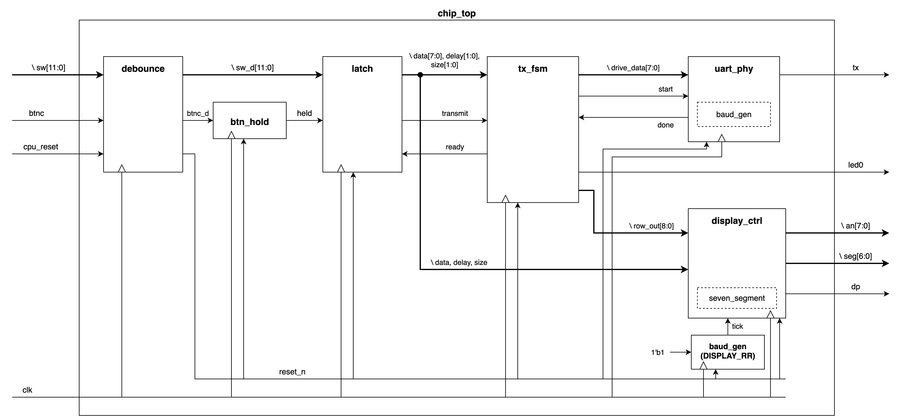
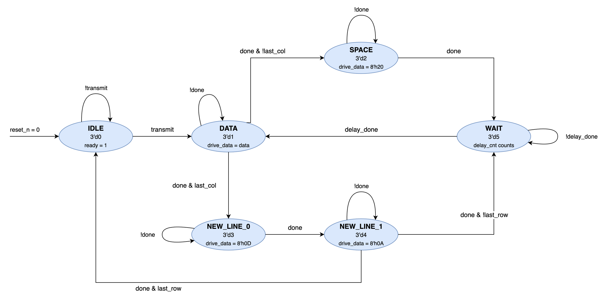
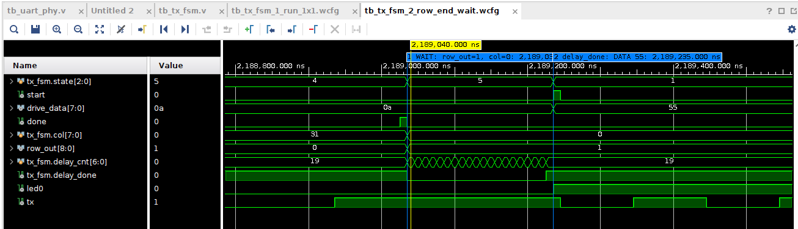
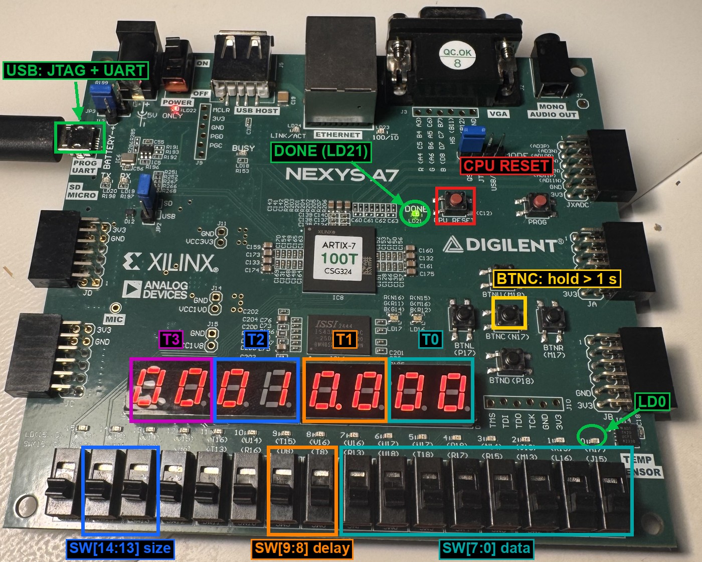
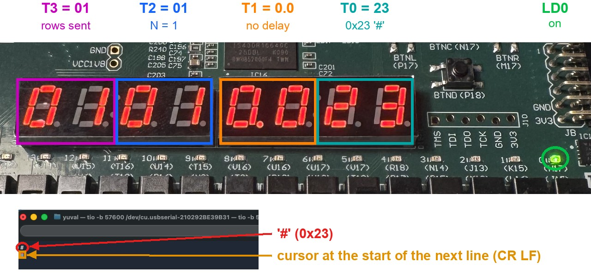
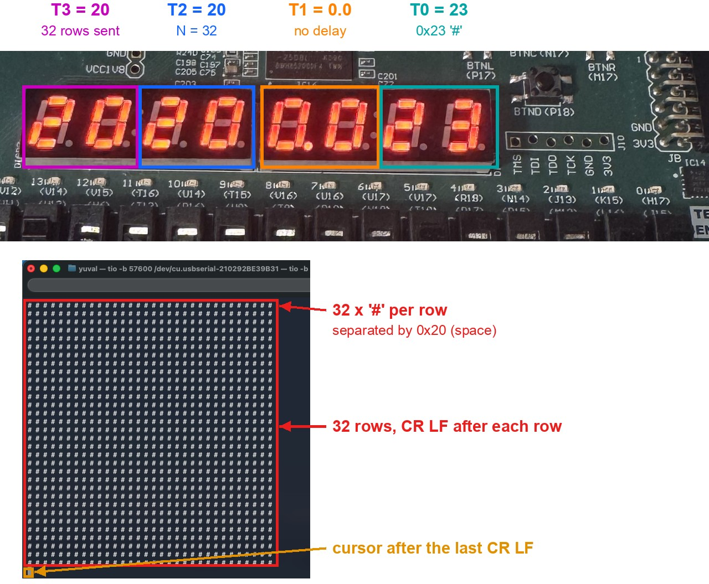
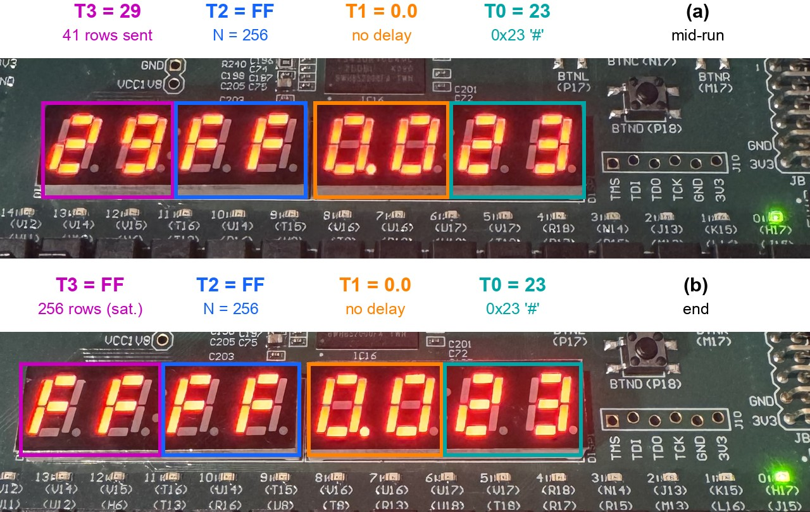
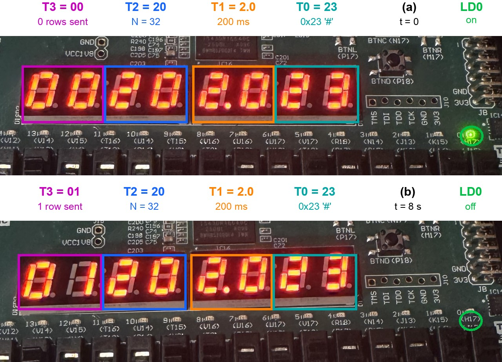

# Lab 4 – TX UART controller

The switches select a byte (`SW[7:0]`), an inter-byte delay (`SW[9:8]`: 0, 50, 100 or 200 ms) and a
square size (`SW[14:13]`: N = 1, 32, 128 or 256). Holding the **center** button for one second latches
them, and the board sends an **N×N square** of that byte to the PC over the on-board USB-UART at
57600 bps, 8N1: a space (`0x20`) after every byte, `CR LF` (`0x0D 0x0A`) at the end of every row.
The 8-digit display shows the configuration and the number of rows sent, and `LED0` toggles with every
data byte. Fully verified in simulation (3 self-checking testbenches, 12 549 checks), lint-clean,
synthesized, placed, routed and tested on the board.



## Architecture

Everything runs on one 100 MHz clock, I didn't divide the clock for anything slow: the UART bit rate and the
display scan are **one-cycle enables** from `baud_gen`, and the 20 ms debounce, the 1 s hold and the inter-byte delay are
counters in the same domain. The path from the button to the line is
`debounce → btn_hold → latch → tx_fsm → uart_phy`, with a `start`/`done` handshake between the byte-level
FSM and the bit-level PHY.

| Module | Function | Registers |
|---|---|---|
| [`chip_top`](rtl/chip_top.v) | instantiates everything; parameters for hardware / simulation timing | 0 |
| [`debounce`](rtl/debounce.v) | 2-FF synchronizer + change detector + 20 ms stability counter, one branch for `CPU_RESETN` (→ `reset_n`) and one for `{SW, BTNC}` | 98 |
| [`btn_hold`](rtl/btn_hold.v) | FSM `IDLE → COUNT → WAIT`: one-clock `held` pulse when `BTNC` has been held for 1 s, nothing more until it is released | 29 |
| [`latch`](rtl/latch.v) | latches data, delay and size on `held & ready` and issues a one-clock `transmit` | 13 |
| [`tx_fsm`](rtl/tx_fsm.v) | byte-level FSM `IDLE / DATA / SPACE / NEW_LINE_0 / NEW_LINE_1 / WAIT`: column, row and delay counters, registered `start` / `drive_data` / `LED0` | 58 |
| [`uart_phy`](rtl/uart_phy.v) | bit-level 8N1 transmitter: 10-bit shift register loaded with `{1, data, 0}`, bit counter, its own `baud_gen` | 25 |
| [`baud_gen`](rtl/baud_gen.v) ×2 | one-clock tick every `100 MHz / BAUD_RATE` clocks: 1736 for the UART, 25 000 for the 4 kHz display scan | 11 / 15 |
| [`display_ctrl`](rtl/display_ctrl.v) | 8-bit anode ring, T0 = byte, T1 = delay (`0.0 / 0.5 / 1.0 / 2.0`), T2 = N, T3 = rows sent | 8 |
| [`seven_segment`](rtl/seven_segment.v) | hex digit → 7 active-low cathodes | 0 |

State diagrams of the three state machines:
[`fsm_tx_fsm`](docs/fsm_tx_fsm.png), [`fsm_uart_phy`](docs/fsm_uart_phy.png), [`fsm_btn_hold`](docs/fsm_btn_hold.png);
the transition tables are in the report.



Parameters make the slow timing simulable:

| Parameter | Hardware | `tb_chip_top` | Meaning |
|---|---|---|---|
| `BAUD_RATE` | 57 600 | 10 000 000 | UART bit rate (10 clocks per bit in simulation) |
| `DISPLAY_RR` | 4 000 | 10 000 000 | display scan tick rate (4 kHz → 500 Hz per digit) |
| `MAX_COUNT_DEBOUNCE` | 2 000 000 | 4 | clocks an input must be stable (20 ms) |
| `MAX_COUNT_BTN_HOLD` | 100 000 000 | 10 | clocks `BTNC` must be held (1 s) |
| `DELAY50` | 5 000 000 | 20 | clocks of the 50 ms delay; 100 / 200 ms are ×2 / ×4 |

Design notes that came up while doing it:

* Checking the baud error: `COUNT = 100M / 57600 = 1736.11` and the integer division keeps 1736, so the actual baud is
  `100M / 1736 = 57 603.69 bps` and the error is `(57 603.69 − 57 600) / 57 600 = +0.0064 %`. The receiver samples each bit
  in its middle, so the error adds up until the stop bit, 9.5 bits after the start edge: `9.5 · 0.0064 % ≈ 0.06 %` of a bit,
  far from the half bit where it would read the wrong bit.
* The switches are sampled only when `tx_fsm` is idle (`ready`), so a press during a run is ignored
  and a run is never reconfigured half way.
* `tx_fsm` moves on only at `uart_phy`'s `done`, and `start`, `drive_data` and `LED0` are registered outputs.
  `WAIT` follows every space and every `CR LF` except the last one; with delay 0 it lasts one clock.
* The row counter is 9 bits wide because N = 256 needs the value 256; T3 shows `FF` once bit 8 is set,
  and T2 shows `FF` for N = 256 as well.
* `dp` is wired to `AN3`, so the decimal point lights on the T1 digit that needs it (`2.0`).

## Verification

Every testbench computes the expected output itself, prints a `PASS`/`FAIL` line per check and ends with
`TEST PASS` / `TEST FAIL`. `tb_chip_top` is built like a small UVM environment: a driver (`drive`,
`btn_press`), a monitor on `tx` that samples each bit in its middle, a predictor (`build_exp`) and a
scoreboard that reports wrong, extra and missing bytes.
Results summary: [`results/1_simulation/simulation_summary.txt`](results/1_simulation/simulation_summary.txt),
full xsim logs in `results/1_simulation/simulation_logs/`, annotated waveform screenshots next to them.

| Testbench | DUT | Checks | What is checked |
|---|---|---|---|
| `tb_uart_phy` | `uart_phy` (10 clocks per bit) | 32/32 | frame `{1, data, 0}` sampled mid-bit by a receiver model, `done` exactly 100 clocks after `start`; `0x00`, `0xAA`, `0x55`, `0xFF`, 10 random bytes, back-to-back bytes |
| `tb_tx_fsm` | `tx_fsm` + `uart_phy` (`DELAY50` = 20) | 8338/8338 | every byte of the run (data, `0x20`, `0x0D 0x0A`), `row_out`, run time including `WAIT`; 1×1 and 32×32 with all four delays |
| `tb_chip_top` | full system (simulation parameters) | 4179/4179 | 1×1 `0x41`; short press → no transmission; 32×32 with delay 1; press during a run ignored; reset during a run (`tx`, `LED0`, `ready`, `row_out`, no more frames) |
| **total** | | **12 549/12 549** | |



## Lint, synthesis, implementation

* **Lint**: Vivado linter on `chip_top` with all sub-modules – 0 violations.
* **Elaborated design**: DRC clean; one methodology advisory (`RFFI-1`: `an_reg[3]` drives both `an[3]`
  and `dp`), which is intended – `opt_design` replicates the anode registers anyway. RTL schematics per
  module in `results/2_lint_and_rtl/`.
* **Synthesis**: 0 errors, 0 critical warnings, 0 warnings. Vivado recognised the `btn_hold` and
  `tx_fsm` state machines and re-encoded `tx_fsm` as one-hot.
* **Implementation** (`results/4_implementation/`): 0 errors, 0 critical warnings, 0 warnings;
  all 432 routable nets routed, DRC and methodology clean. Critical path: `latch_i/delay_reg[1]` →
  the `delay_cnt` compare (CARRY4 chain) → `tx_fsm_i/drive_data_reg[0]/CE`, 7.376 ns, 9 logic levels.

| Resource | Used | Available |
|---|---|---|
| Slice LUTs | 164 (170 after synthesis) | 63 400 |
| Flip-flops | 255 (246 in RTL + 9 replicas of the anode registers made by `opt_design`: one per `AN` pin and one more for `dp`) | 126 800 |
| CARRY4 | 41 | |
| I/O | 33 | 210 |
| BRAM / DSP | 0 / 0 | |
| Worst setup slack @ 100 MHz | 2.264 ns | |
| Worst hold slack | 0.122 ns | |
| Power (estimate) | 0.100 W | |

I also synthesized each module out-of-context, the per-module numbers are in
[`results/5_resource_usage/per_module_out_of_context/summary.txt`](results/5_resource_usage/per_module_out_of_context/summary.txt).
Most of the flip-flops are long counters (debounce, the 1 s hold, the 200 ms delay).

## On the board

On macOS I used [tio](https://github.com/tio/tio) as the terminal. It also logs everything the board sends:

```sh
tio -b 57600 --log --log-file "$PWD/output.txt" --log-strip /dev/cu.usbserial-210292BE39B31
```

In the photos I marked each switch group in the colour of the display field it sets. The byte is `0x23` (`#`) in all the cases.

| | | |
|---|---|---|
|  |  |  |
| programmed: `DONE` on, reset state | 1×1 – one `#`, then `CR LF` | 32×32 – display and terminal |
|  |  | |
| 256×256 – T3 mid-run (`29` = 41 rows), then saturated at `FF` | 32×32, 200 ms – one row every ~6.4 s, `LED0` blinks per byte | |

The terminal log [`board_test/output.txt`](board_test/output.txt) holds six more runs: 1×1, 32×32, 128×128 and
256×256 of `#`, and 32×32 and 128×128 of `$`. Every run is an exact N×N square (N bytes per row with single
spaces and no trailing space, N rows) – 100 353 data bytes, no errors.

Submitted report (Hebrew, with every waveform, FSM transition table and report excerpt): [`docs/lab4_report.pdf`](docs/lab4_report.pdf).

## Files

```
rtl/          9 modules, one per file
tb/           3 testbenches
constraints/  nexys_a7_100t.xdc – CLK100MHZ, CPU_RESETN, BTNC, SW[9:0], SW[14:13], LED0, CA..CG, DP, AN, UART_RXD_OUT
docs/         block diagram, the three FSM diagrams, lab4_report.pdf
results/      1_simulation  2_lint_and_rtl  3_synthesis  4_implementation  5_resource_usage
              bitstream_summary.txt
board_test/   annotated photos, output.txt (tio log)
```
