# Lab 5 – UART TRX controller

Lab 4's transmitter plus a UART receiver, rewritten in SystemVerilog. `SW[15]` selects the mode and `LED15` shows it:

* **TX** (`SW[15]` = 0) works as in Lab 4. The switches select a byte (`SW[7:0]`), an inter-byte delay
  (`SW[9:8]`: 0, 50, 100 or 200 ms) and a square size (`SW[14:13]`: N = 1, 32, 128 or 256). Holding the
  **center** button for one second latches them, and the board sends an **N×N square** of that byte to the PC
  at 57600 bps, 8N1.
* **RX** (`SW[15]` = 1): the PC sends a 16-byte message `{Rddd,Cddd,Vddd}` (three decimal digits per field, the
  letters in upper or lower case). The board checks it and shows the row, the column and the value in hex on the
  8-digit display. A message with a wrong format or a number above 255 is dropped, and the display keeps the last
  good one.

Each of the 15 modules has its own testbench, and the design is lint-clean, synthesized, placed, routed and
tested on the board.

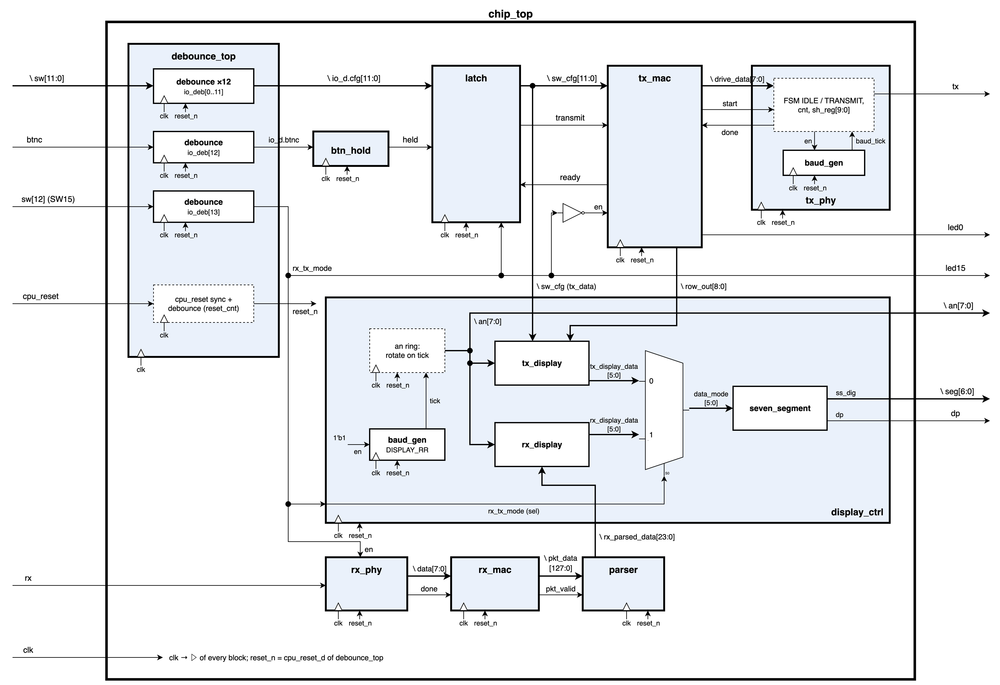

## Architecture

Everything runs on one 100 MHz clock. The UART bit rate, the 16× RX oversampling and the display scan are
one-cycle ticks from counters, not divided clocks. All the board inputs go through `debounce_top` first, and its
`CPU_RESETN` branch makes `reset_n` for the whole design. The two paths are

* TX: `debounce_top → btn_hold → latch → tx_mac → tx_phy`
* RX: `rx_phy → rx_mac → parser → display_ctrl`

and only one of them works at a time (no full duplex): `tx_mac` gets `en = !rx_tx_mode`, `rx_phy` gets
`en = rx_tx_mode`, and `latch` latches only in TX mode.

| Module | Function | Flip-flops (RTL) |
|---|---|---|
| [`chip_top`](rtl/chip_top.sv) | instantiates everything; `SW[15]` → `rx_tx_mode` → the two `en` inputs and `LED15` | 0 |
| [`lab5_pkg`](rtl/lab5_pkg.sv) | widths, ASCII constants, the FSM enums and the structs for the switch configuration, the message and the display | – |
| [`lab5_definitions.svh`](rtl/lab5_definitions.svh) | the five timing values, with short ones when `SIM` is defined | – |
| [`debounce_top`](rtl/debounce_top.sv) | 14 `debounce` instances (12 configuration bits, `BTNC`, `SW[15]`) and the `CPU_RESETN` branch: 2-FF sync and a 20 ms counter → `reset_n` | 375 |
| [`debounce`](rtl/debounce.sv) | 2-FF synchronizer + FSM `DEB_S0 / DEB_W1 / DEB_S1 / DEB_W0` with a 20 ms stability counter | 25 each |
| [`btn_hold`](rtl/btn_hold.sv) | FSM `BTN_IDLE → BTN_COUNT → BTN_WAIT`: one `held` pulse after 1 s, nothing more until the button is released | 29 |
| [`latch`](rtl/latch.sv) | latches the configuration on `ready & held & !rx_tx_mode` and gives a one-clock `transmit` | 13 |
| [`tx_mac`](rtl/tx_mac.sv) | byte-level FSM `TX_MAC_IDLE / DATA / SPACE / NEW_LINE_0 / NEW_LINE_1 / DELAY`: column, row and delay counters, registered `start` / `drive_data` / `led0` | 55 |
| [`tx_phy`](rtl/tx_phy.sv) | bit-level 8N1 transmitter: 10-bit shift register loaded with `{1, data, 0}`, bit counter, its own `baud_gen` | 26 |
| [`baud_gen`](rtl/baud_gen.sv) ×2 | one-clock tick every `100 MHz / rate` clocks: 1736 for the UART, 25 000 for the 4 kHz display scan | 11 / 15 |
| [`rx_phy`](rtl/rx_phy.sv) | 2-FF sync, falling-edge detect, 16 ticks per bit; FSM `RX_PHY_IDLE / START / DATA / STOP`: the start bit needs 3 low samples in its middle, every data bit is sampled at tick 7 | 32 |
| [`rx_mac`](rtl/rx_mac.sv) | message FSM `RX_MAC_IDLE / OPCODE / VALUE / DONE_NEXT`: checks the structure byte by byte and shifts every byte into a 128-bit register (16 bytes); one-clock `pkt_valid` on `}` | 135 |
| [`parser`](rtl/parser.sv) | checks the letters (R, C, V in either case) and the commas, converts each field to binary, drops values above 255, keeps the last good message | 25 |
| [`display_ctrl`](rtl/display_ctrl.sv) | 8-bit anode ring on a 4 kHz tick (500 Hz per digit); takes `tx_display` or `rx_display` by the mode and feeds `seven_segment` | 23 |
| [`tx_display`](rtl/tx_display.sv) | TX fields: T0 = byte, T1 = delay (`0.0 / 0.5 / 1.0 / 2.0`), T2 = N, T3 = rows sent | 0 |
| [`rx_display`](rtl/rx_display.sv) | RX fields: T0 = value, T1 = `--`, T2 = column, T3 = row, in hex | 0 |
| [`seven_segment`](rtl/seven_segment.sv) | hex digit or dash → 7 active-low cathodes | 0 |

The flip-flop column is what I counted in the RTL before synthesis, each module together with its sub-modules
(`debounce` is inside `debounce_top`, the two `baud_gen`s inside `tx_phy` and `display_ctrl`). The top-level rows
add up to 713.

State diagrams of the six state machines:
[`fsm_debounce`](docs/fsm_debounce.png), [`fsm_btn_hold`](docs/fsm_btn_hold.png), [`fsm_tx_mac`](docs/fsm_tx_mac.png),
[`fsm_tx_phy`](docs/fsm_tx_phy.png), [`fsm_rx_phy`](docs/fsm_rx_phy.png), [`fsm_rx_mac`](docs/fsm_rx_mac.png);
the transition tables are in the report.

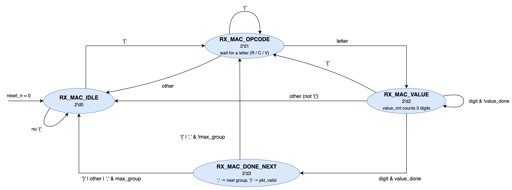

`lab5_definitions.svh` holds the slow timing values, with short ones for the simulation (`SIM` defined):

| Define | Hardware | `SIM` | Meaning |
|---|---|---|---|
| `BAUD_RATE` | 57 600 | 6 250 000 | UART bit rate (16 clocks per bit in simulation, TX and RX) |
| `DEB_COUNT` | 2 000 000 | 10 | clocks an input must be stable (20 ms) |
| `BTN_HOLD_COUNT` | 100 000 000 | 20 | clocks `BTNC` must be held (1 s) |
| `DELAY_50MS_VAL` | 5 000 000 | 10 | clocks of the 50 ms delay; 100 / 200 ms are ×2 / ×4 |
| `DISPLAY_RR` | 4 000 | 10 000 000 | display scan tick rate (a tick every 10 clocks in simulation) |

Design notes that came up while doing it:

* RX baud: `TICK_CNT = 100M / (57600 · 16) = 108.51` and the integer division keeps 108, so one RX bit is
  `16 · 108 = 1728` clocks instead of 1736.11, 0.47 % short. The stop bit is sampled 9.5 bits after the falling
  edge of the start bit, so the drift adds up to `9.5 · (1736.11 − 1728) ≈ 77` clocks, 4.4 % of a bit.
* The simulation baud rate is 6.25 MHz = `CLK_FREQ / 16`, the fastest rate where 16× oversampling still works:
  `TICK_CNT` = 1, a tick every clock, and a bit is 16 clocks in both the transmitter and the receiver.
* `chip_top`'s ports are plain vectors and not structs. With a struct port, synthesis flattened the field names,
  the `get_ports` in the XDC found no port and the flow failed.
* ASCII → binary: an ASCII digit is `0x30`–`0x39`, so its value is the low nibble, with no subtraction.
  `100 · d2 + 10 · d1 + d0 ≤ 999` needs 10 bits, and anything above 255 is dropped because row, column and value
  are 8 bits.
* Counter widths: a counter that reaches MAX itself needs `$clog2(MAX + 1)` bits. `row_out` reaches 256, so it is
  `$clog2(256) + 1 = 9` bits.
* I simplified the `DONE_NEXT → IDLE` condition of `rx_mac` with a Karnaugh map. `is_start`, `is_comma` and
  `is_end` exclude each other, so their overlaps are don't-cares and `is_end` drops out:
  `next = IDLE ⇔ done · (¬is_comma · ¬is_start + max_group · is_comma)`.
* `pkt_valid` is decided from the incoming byte (`DONE_NEXT`, `done` and `}`) and registered. Taken from the
  state after the transition, it would come one byte late.
* Bug found on the board: in RX mode a 1 s `BTNC` hold sent one byte and toggled `LED0`. `latch` had no mode
  condition (`ready & held`), and `tx_mac`'s `ready` is 1 in RX mode too, so `transmit` rose. `tx_mac`'s `en`
  blocked only the next state and not `start`, so one `start` pulse reached `tx_phy`. The fix is
  `latch_en = ready & held & !rx_tx_mode`.
* Bug found in `tb_tx_mac`: after a run stopped by `en` = 0, `col_cnt` kept its value and the next run started
  in the wrong column. `col_cnt` now also clears on `TX_MAC_IDLE & transmit`.

## Verification

Every testbench checks its DUT with immediate `assert`s and SVA properties, and a failed check prints an
`ERROR` line in the xsim log. All 15 logs end without an `ERROR` (63 immediate assertions and 15 SVA properties).
`tb_tx_display`, `tb_seven_segment` and `tb_chip_top` have no assertions, so I checked them in the waveforms.
I annotated every waveform screenshot: numbered markers on the events, and a coloured box with a tag on the
signals that show them.
Results summary: [`results/1_simulation/simulation_summary.txt`](results/1_simulation/simulation_summary.txt),
xsim logs in `results/1_simulation/simulation_logs/`, the annotated waveforms and their wave configs next to them.

| Testbench | DUT | Assertions (immediate + SVA) | What the waveforms show |
|---|---|---|---|
| [`tb_debounce`](tb/tb_debounce.sv) | `debounce` | 11 + 1 | a stable change, short pulses, reset |
| [`tb_debounce_top`](tb/tb_debounce_top.sv) | `debounce_top` (14 × `debounce`) | 0 + 2 | power-on reset, a walking 1 over the 14 inputs, reset and short pulses |
| [`tb_btn_hold`](tb/tb_btn_hold.sv) | `btn_hold` | 3 + 3 | a normal, a short and a long press, reset in the middle |
| [`tb_latch`](tb/tb_latch.sv) | `latch` | 1 + 2 | every combination of `rx_tx_mode`, `held` and `ready` |
| [`tb_tx_mac`](tb/tb_tx_mac.sv) | `tx_mac` | 7 + 0 | a 1×1 run of `0xBB`; the end of the first row of a 128×128 run with delay 1; `en` = 0 in the middle of a run, then a new run |
| [`tb_tx_phy`](tb/tb_tx_phy.sv) | `tx_phy` + `baud_gen` | 4 + 2 | the frame of `0xA5` |
| [`tb_baud_gen`](tb/tb_baud_gen.sv) | `baud_gen` | 6 + 3 | a full count, `en` = 0 in the middle, reset |
| [`tb_rx_phy`](tb/tb_rx_phy.sv) | `rx_phy` | 7 + 2 | receiving `0xA5`; `en` = 0 in the middle of the frame `0x84` |
| [`tb_rx_mac`](tb/tb_rx_mac.sv) | `rx_mac` | 11 + 0 | `{R123,C456,V789}`; a non-digit, an empty message and a `{` in the middle of a message; a one-group and a four-group message |
| [`tb_parser`](tb/tb_parser.sv) | `parser` | 6 + 0 | nine messages |
| [`tb_rx_display`](tb/tb_rx_display.sv) | `rx_display` | 3 + 0 | two values over the eight anodes |
| [`tb_tx_display`](tb/tb_tx_display.sv) | `tx_display` | 0 + 0 | N = 256 with the four delays |
| [`tb_seven_segment`](tb/tb_seven_segment.sv) | `seven_segment` | 0 + 0 | digits 0 to 3 with `dp` = 0 and 1; digits D to F and the dash |
| [`tb_display_ctrl`](tb/tb_display_ctrl.sv) | `display_ctrl` | 4 + 0 | reset and one scan of the eight digits |
| [`tb_chip_top`](tb/tb_chip_top.sv) | full system (`SIM` values) | 0 + 0 | a `BTNC` press up to the first start bit; the end of `{r010,c020,v255}` and its decoding; the display scan in RX mode; `{R300,C005,V009}` dropped and a `BTNC` press in RX mode |
| **total** | | **63 + 15** | |

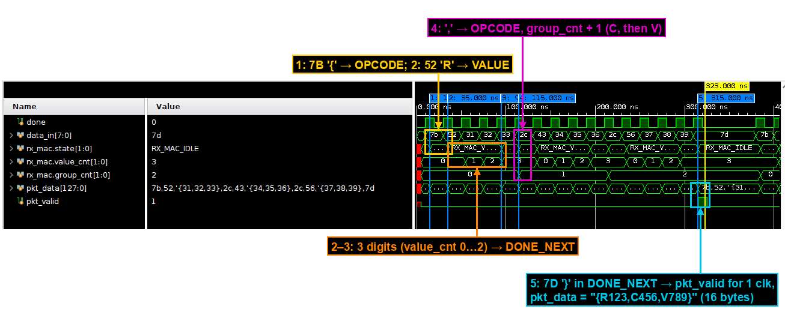

## Lint, synthesis, implementation

* **Lint**: Vivado linter on `chip_top` with all sub-modules – 0 violations.
* **Elaborated design**: DRC and methodology clean. RTL schematic of `chip_top` in `results/2_lint_and_rtl/`.
* **Constraints**: one clock (`create_clock` on `clk`, 10 ns). The inputs are synchronized inside the design and
  the outputs are slow, so the XDC has a `set_false_path` for both.
* **Synthesis**: 0 errors, 0 critical warnings, 52 warnings, all `[Synth 8-7129]`: `pkt_data` bits that `parser`
  doesn't read (the high nibble of each ASCII digit, and the `{` and `}` bytes that `rx_mac` already checked).
  The state machines of `btn_hold`, `tx_mac` and `rx_mac` were re-encoded one-hot.
* **Implementation** (`results/4_implementation/`): 0 errors, 0 critical warnings, 0 warnings; all 1140 routable
  nets routed, DRC and methodology clean. Critical path: `rx_mac_i/pkt_data_reg[col_index][2][0]` → the column
  conversion and the `> 255` check in `parser` (4 CARRY4) → `parser_i/rx_parsed_data_reg[pixel_value][0][1]/CE`,
  7.629 ns, 8 logic levels.

| Resource | Used | Available |
|---|---|---|
| Slice LUTs | 667 (675 after synthesis), 11 of them SRL16E | 63 400 |
| Flip-flops | 695 (687 after synthesis, 713 in the RTL) | 126 800 |
| CARRY4 | 136 | |
| I/O | 36 (17 inputs, 19 outputs) | 210 |
| BUFG | 1 | 32 |
| BRAM / DSP | 0 / 0 | |
| Worst setup slack @ 100 MHz | 2.127 ns | |
| Worst hold slack | 0.099 ns | |
| Power (estimate) | 0.104 W | |

I counted the flip-flops from the RTL before synthesis (713) and compared them with the out-of-context run of
each module (720 together) and with the full design (687 after synthesis, 695 after placement). The differences:

1. `btn_hold`, `tx_mac` and `rx_mac` are one-hot: 3, 6 and 4 state flip-flops instead of 2, 3 and 2 (+6).
2. `tx_phy`: `sh_reg[9]` is always 1 (loaded with 1, shifts in 1), so it is removed (−1).
3. `rx_phy` keeps its state register twice, as `FSM_sequential_state_reg` and `state_reg`, 2 bits each (+2).
   Together that is the +7 of the out-of-context sum.
4. Full design: `parser`'s `msg_valid` output is not connected in `chip_top` and is removed (−1).
5. Full design: in `rx_mac`, 12 flip-flops nothing reads are removed (`msg_start`, `r[5]` – the only bit where `R`
   and `r` differ – and bit 5 of the three row digits). 24 stages of the `pkt_data` shift register move into
   11 SRL16E with 4 more flip-flops, so `rx_mac` has 105 instead of 137 (−32).
6. After placement, `opt_design` copies every `an` bit to `an_reg[i]_lopt_replica`, which drives only its pin (+8).

The per-module numbers are in
[`results/5_resource_usage/per_module_out_of_context/summary.txt`](results/5_resource_usage/per_module_out_of_context/summary.txt).

## On the board

The TX path didn't change since Lab 4, so the TX cases (photos 2–5) and the terminal log
[`board_test/output.txt`](board_test/output.txt) are from the Lab 4 board test (see
[Lab 4 – On the board](../lab4_tx_uart_controller/README.md#on-the-board)). I tested the RX cases on this lab's
bitstream and sent the messages from CoolTerm at 57600 bps, 8N1. In the photos every display field has a coloured
box and a tag with what it shows.

| Case | Message | Display (T3 T2 T1 T0) | What it checks |
|---|---|---|---|
| 5 | `{R001,C002,V003}` | `01 02 -- 03` | a normal message |
| 6 | `{r004,c005,v006}` | `04 05 -- 06` | lower-case letters |
| 7 | `{R255,c255,V255}` | `FF FF -- FF` | the largest value in all three fields |
| 8 | `{a,b,c001}` | `FF FF -- FF` (kept) | wrong format: `rx_mac` drops the message |
| 9 | `{R004,{R005,C020,V100}` | `05 14 -- 64` | a `{` in the middle starts a new message |
| 10 | `{R256,C256,V256}` | `05 14 -- 64` (kept) | values above 255: `parser` drops the message |

| | | |
|---|---|---|
| 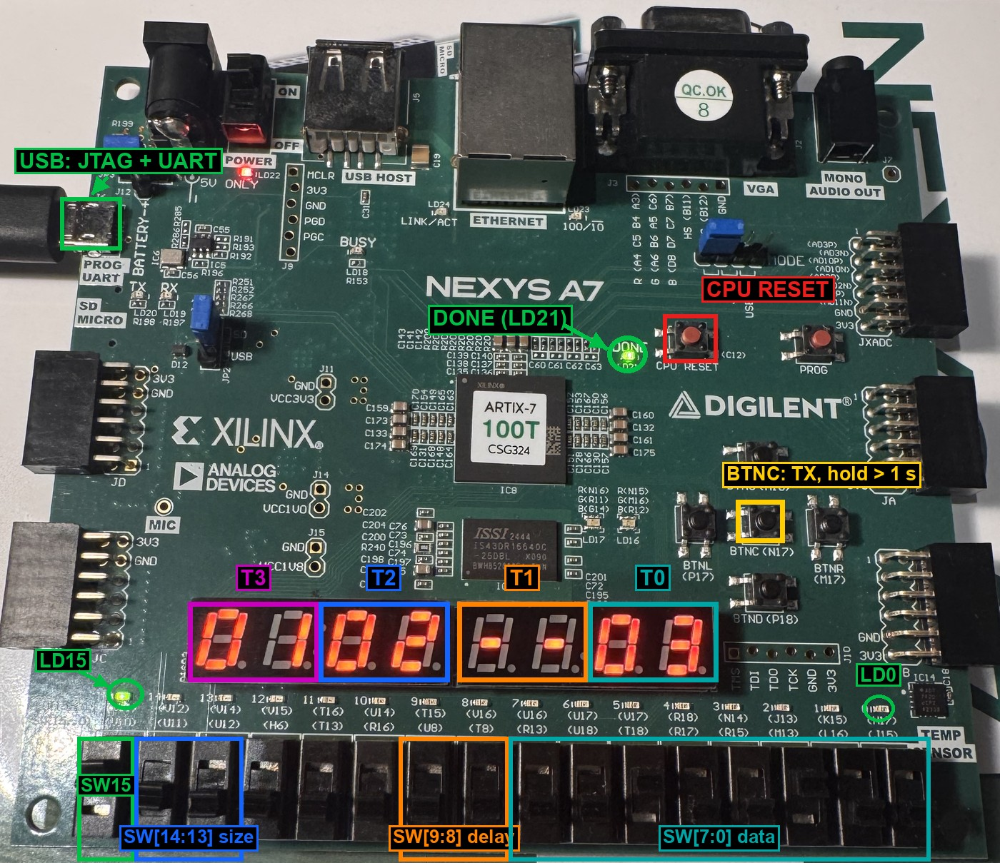 | 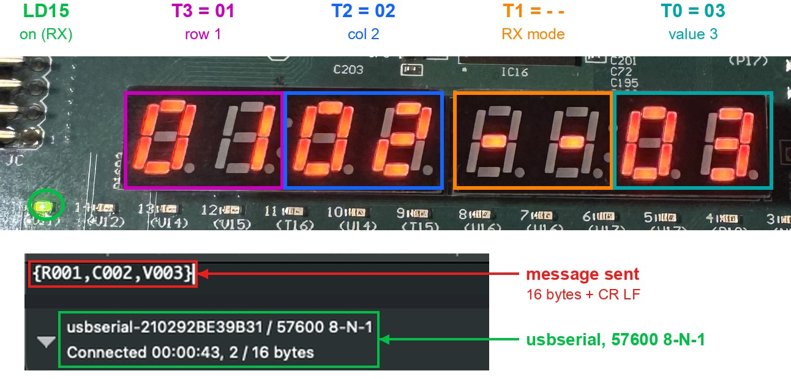 | 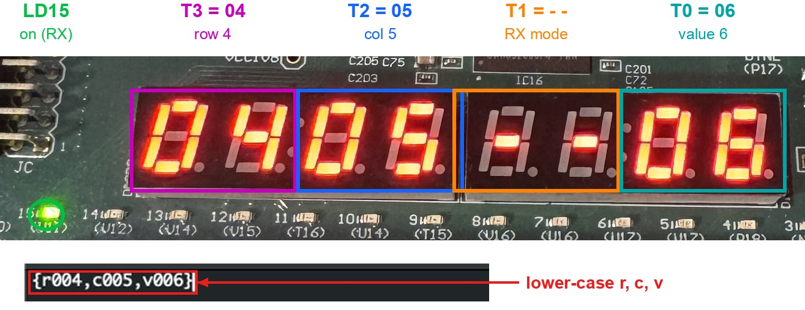 |
| programmed: `DONE` on, `LD15` on (RX mode) | case 5 – `{R001,C002,V003}` | case 6 – lower case |
| 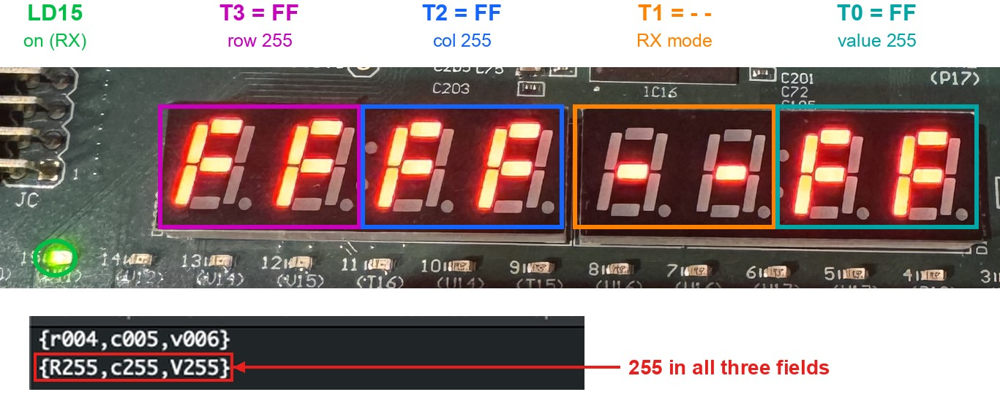 | 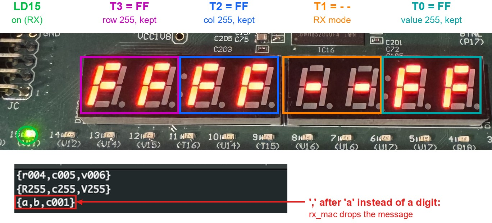 | 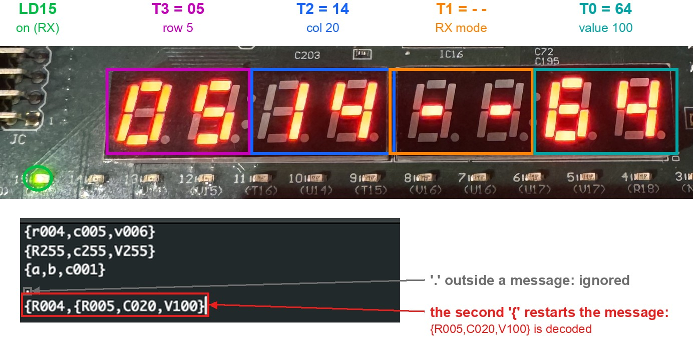 |
| case 7 – 255 in every field | case 8 – wrong format, display kept | case 9 – a new `{` restarts the message |
| 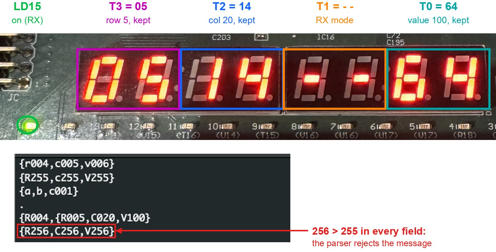 | 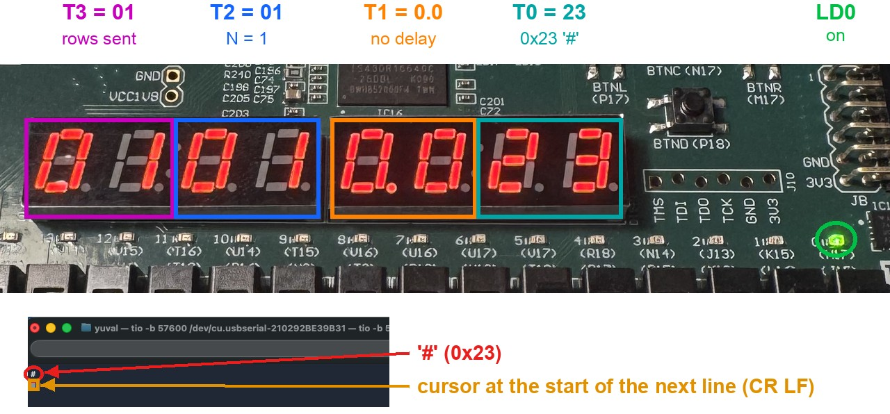 | 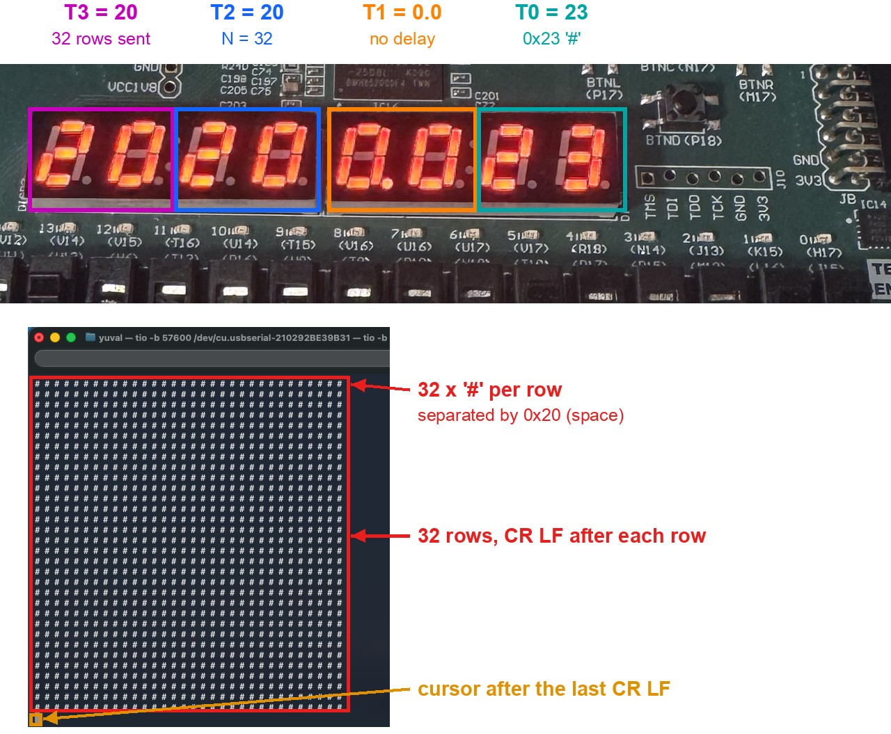 |
| case 10 – 256, display kept | TX 1×1 of `#` (Lab 4) | TX 32×32 of `#` (Lab 4) |

Submitted report (Hebrew, with every waveform, FSM transition table and report excerpt): [`docs/lab5_report.pdf`](docs/lab5_report.pdf).

## Files

```
rtl/          15 modules, one per file, plus lab5_pkg.sv and lab5_definitions.svh
tb/           15 testbenches, one per module
constraints/  nexys_a7_100t.xdc – CLK100MHZ, CPU_RESETN, BTNC, SW[9:0], SW[15:13], LED0, LED15, CA..CG, DP, AN,
              UART_TXD_IN, UART_RXD_OUT
docs/         block diagram, the six FSM diagrams, lab5_report.pdf
results/      1_simulation  2_lint_and_rtl  3_synthesis  4_implementation  5_resource_usage
              bitstream_summary.txt
board_test/   annotated photos, output.txt (tio log of the TX cases, from Lab 4)
```
