# Lab 6 – PWM controller for an RGB LED

The PC sends an sRGB pixel over UART, and the board lights one of its two RGB LEDs (`LED16` or `LED17`) in that
colour with PWM. Each colour goes through the gamma table and a CIE luminance weight before its PWM channel, and the
board sends the values it drives back to the PC.

* **UART RX** (57600 bps, 8N1): `{Rddd,Gddd,Bddd}` sets the pixel (three decimal digits per colour, 0 to 255) and
  `{L016}` / `{L017}` selects the LED. The letters can be upper or lower case. A packet with a wrong format, a colour
  above 255 or an LED other than 16 / 17 is dropped, and the board keeps the last good values.
* **Buttons**: `BTNL` / `BTNR` move the cursor between the four display fields, `BTNU` / `BTND` change the selected
  field by 1, and `BTNC` applies the edited pixel and LED to the PWM. The cursor and the values stop at the edges.
* **Display** (hex): T0 = blue, T1 = green, T2 = red, T3 = the LED (`01` = `LED16`, `10` = `LED17`). The pair of
  green LEDs under the selected field shows the cursor.
* **PWM**: 1024 slots per period, 97.66 kHz at 100 MHz. The size is a `chip_top` parameter: 512, 1024, 2048, 4096
  or 8192 slots.
* **UART TX**: every new pixel (a packet or `BTNC`) sends back `{Rdddd,Gdddd,Bdddd}`, the three PWM values after
  gamma and CIE.

Each of the 17 modules has its own testbench, and the design is lint-clean, synthesized, placed, routed and
tested on the board.

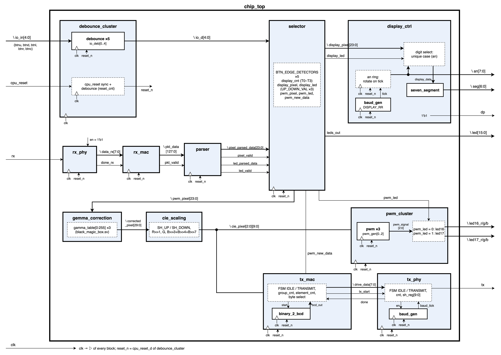

## Architecture

Everything runs on one 100 MHz clock. The UART bit rate, the 16× RX oversampling and the display scan are
one-clock ticks from counters, not divided clocks. The five buttons go through `debounce_cluster` first, and its
`CPU_RESETN` branch makes `reset_n` for the whole design. The paths are

* RX: `rx_phy → rx_mac → parser → selector`
* LED: `selector → gemma_correction → cie_scaling → pwm_cluster`
* TX: `cie_scaling → tx_mac → tx_phy`

`selector` keeps two copies of the pixel and of the LED bit. `display_pixel` / `display_led` go to the display and
change with the buttons. `pwm_pixel` / `pwm_led` go to the PWM and change only on `BTNC` or on a new packet. A pixel
packet loads both copies and starts a TX reply (`pwm_new_data`). An LED packet loads both LED bits and sends nothing.

| Module | Function | Flip-flops (RTL) |
|---|---|---|
| [`chip_top`](rtl/chip_top.sv) | instantiates everything; parameters `BAUD_RATE`, `DEB_COUNT`, `DISPLAY_RR`, `SLOTS` | 0 |
| [`lab6_pkg`](rtl/lab6_pkg.sv) | widths, ASCII constants, the packet and pixel structs, the FSM enums | – |
| [`lab6_definitions.svh`](rtl/lab6_definitions.svh) | the four hardware values, with short ones when `SIM` is defined | – |
| [`debounce_cluster`](rtl/debounce_cluster.sv) | 5 `debounce` instances (`generate`) and the `CPU_RESETN` branch: 2-FF sync and a 20 ms counter → `reset_n` | 150 |
| [`debounce`](rtl/debounce.sv) | 2-FF synchronizer + FSM `DEB_S0 / DEB_W1 / DEB_S1 / DEB_W0` with a 20 ms stability counter | 25 each |
| [`rx_phy`](rtl/rx_phy.sv) | 16 ticks per bit; FSM `RX_PHY_IDLE / START / DATA / STOP`: the start bit needs 3 low samples in its middle, every data bit is sampled at tick 7 | 32 |
| [`rx_mac`](rtl/rx_mac.sv) | packet FSM `RX_MAC_IDLE / OPCODE / VALUE / DONE_NEXT`: checks the structure byte by byte (`{`, letter, three digits, `,`, `}`) and shifts each byte into a 128-bit register; one-clock `pkt_valid` on `}` | 135 |
| [`parser`](rtl/parser.sv) | checks the letters (R, G, B or L, either case), converts each field to binary, drops colours above 255 and LEDs other than 16 / 17; one-clock `pixel_valid` / `led_valid` | 27 |
| [`selector`](rtl/selector.sv) | edge detector per button, the cursor (`display_cnt`, 2 bits, stops at T0 and T3), editing that stops at 0 and 255, the display and PWM copies, `pwm_new_data` | 58 |
| [`display_ctrl`](rtl/display_ctrl.sv) | 8-bit anode ring on a 4 kHz tick (500 Hz per digit), picks the nibble of the active digit for `seven_segment` | 23 |
| [`seven_segment`](rtl/seven_segment.sv) | hex digit → 7 active-low cathodes | 0 |
| [`gemma_correction`](rtl/gemma_correction.sv) | three reads of the given 256 × 10-bit `gamma_table` ([`black_magic_box.sv`](rtl/black_magic_box.sv)), one per colour | 0 |
| [`cie_scaling`](rtl/cie_scaling.sv) | shifts the 10-bit table value to `SLOTS_WIDTH`, then applies the Rec.601 weights normalised to red: R × 1, G × (1/2 + 1/128), B × 1 | 0 |
| [`pwm_cluster`](rtl/pwm_cluster.sv) | 3 `pwm` instances; `pwm_led` routes them to `LED16` or `LED17`, and the other LED is off | 63 |
| [`pwm`](rtl/pwm.sv) | counter 0 … `SLOTS − 1`, `pwm_signal = cnt < value_reg`; `value_reg` loads only at the end of a period | 21 each |
| [`tx_mac`](rtl/tx_mac.sv) | FSM `TX_IDLE / TX_TRANSMIT`: 4 groups × 6 elements give the 19 bytes of `{Rdddd,Gdddd,Bdddd}`; `start_mid_trans` keeps one start that comes during a reply | 40 |
| [`binary_2_bcd`](rtl/binary_2_bcd.sv) | double dabble inside `tx_mac`, one shift per bit, 4 BCD digits | 32 (in `tx_mac`) |
| [`tx_phy`](rtl/tx_phy.sv) | bit-level 8N1 transmitter: 10-bit shift register loaded with `{1, data, 0}`, bit counter, its own `baud_gen` | 26 |
| [`baud_gen`](rtl/baud_gen.sv) ×2 | one-clock tick every `100 MHz / rate` clocks: 1736 for the UART, 25 000 for the display scan | 11 / 15 |

The flip-flop column is what I counted in the RTL before synthesis, each module together with its sub-modules
(`debounce` is inside `debounce_cluster`, `pwm` inside `pwm_cluster`, `binary_2_bcd` inside `tx_mac`, the two
`baud_gen`s inside `tx_phy` and `display_ctrl`). The top-level rows add up to 554.

State diagrams of the five state machines:
[`fsm_debounce`](docs/fsm_debounce.png), [`fsm_rx_phy`](docs/fsm_rx_phy.png), [`fsm_rx_mac`](docs/fsm_rx_mac.png),
[`fsm_tx_mac`](docs/fsm_tx_mac.png), [`fsm_tx_phy`](docs/fsm_tx_phy.png); the transition tables are in the report.

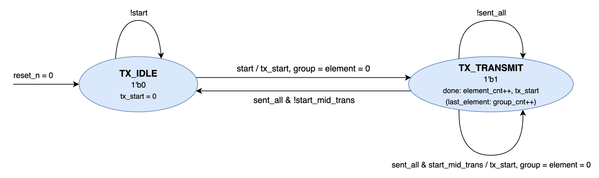

`lab6_definitions.svh` holds the hardware values, with short ones for the simulation (`SIM` defined):

| Define | Hardware | `SIM` | Meaning |
|---|---|---|---|
| `BAUD_RATE` | 57 600 | 6 250 000 | UART bit rate (16 clocks per bit in simulation, TX and RX) |
| `DEB_COUNT` | 2 000 000 | 10 | clocks an input must be stable (20 ms) |
| `DISPLAY_RR` | 4 000 | 10 000 000 | display scan tick rate (a tick every 10 clocks in simulation) |
| `SLOTS` | 1 024 | 64 | PWM slots per period |

Design notes that came up while doing it:

* CIE scaling: Rec.601 gives `Y = 0.299 R + 0.587 G + 0.114 B`, so at the same duty cycle green looks 1.96× as
  bright as red and 5.15× as bright as blue. Normalising to one colour multiplies every colour by
  `K_norm / K_colour`, so at full scale each colour adds as much to `Y` as the normalising colour does.
  Normalised to red:
  1. R × 1
  2. G × 0.299 / 0.587 = 0.509 ≈ 1/2 + 1/128 = 0.5078 (−0.3 %) → `(g >> 1) + (g >> 7)`, one adder, no multiplier
  3. B × 0.299 / 0.114 = 2.62, more than 100 % duty, so it is clamped to 1

  White `{R255,G255,B255}` becomes `{R1023,G0518,B1023}`.
* Why red: I compared the normalisations in the report (section 2.5). Blue is the only one where all three colours
  are balanced, but white gets only 34 % of the brightness (`Y` = 3 · 0.114). Red gives 71 % (0.299 + 0.299 + 0.114)
  and still balances red and green; above red, more brightness unbalances them. My criterion was brightness over
  perfect balance, so I chose red. The cost is blue, which stays 2.62× weaker than red and green.
* My first `cie_scaling` multiplied each colour by its weight instead of dividing by it. Green, which the eye
  already sees strongest, got stronger, and white looked green on the board. The testbench couldn't catch it,
  because it checked the RTL against my own model; only the photo of white showed it.
* `SLOTS`: `cie_scaling` shifts the table value to `SLOTS_WIDTH` before the weights (`SH_UP` / `SH_DOWN` in a
  `generate`), so the duty cycle is the same for every size: table value 600 is 58.6 % at 512, 1024 and 8192 slots.
  At 512 the table LSB is lost, so 1024 is the smallest size without loss. Shifting first also keeps small values:
  at 8192 a table value of 1 becomes 8 and green keeps 4, while weighting first would give 0.
* The gamma table limits the colour resolution: its 256 inputs give only 238 different 10-bit levels. After CIE, red
  and blue keep 238 levels, green 217, and green turns on only from sRGB 5. More slots don't add levels, because
  the shift only multiplies the same ones.
* `SLOTS_WIDTH` comes from each module's own `SLOTS` parameter and not from the package. A package `localparam` or
  struct is fixed by the define at compile time, and overriding the parameter in `chip_top` didn't reach it. This
  bug came back three times until I removed those definitions from the package.
* Gamma table in Block RAM: synthesized alone, `gemma_correction` maps the table to LUTs. In the full design the
  table address comes straight from the `pwm_pixel` register in `selector`, so synthesis takes `pwm_pixel` into two
  RAMB18E1 as their address register, and the table becomes a ROM (write enable tied to 0). This gives two SYNTH-6
  methodology warnings (no output register in the block). The worst path through the blocks still has 3.565 ns of
  slack, so I left it this way.
* `binary_2_bcd` is sequential. A combinational version with `/` and `%` by 10, 100 and 1000 failed timing at
  100 MHz (WNS −0.81 ns after implementation, from `pwm_pixel` through the table, CIE and the dividers to `tx_phy`).
  The sequential one starts with the opener byte of each group (`{` or `,`) and is done long before its digits are
  sent two bytes later.
* A start that comes during a reply is kept in one flag (`start_mid_trans`), and the next reply goes out right after
  the `}`. Restarting would break the byte already on the line, and a FIFO would send values that are no longer
  shown. One reply with the latest values is enough.
* `debounce` came from Lab 5 with an asynchronous reset. With the table in Block RAM, the RAM enable went through
  the `BTNC` debounce state register and gave three REQP-1840 DRC warnings (asynchronous control of a RAMB18). I
  changed it to a synchronous reset like the rest of the design, and the warnings went away.
* Bugs found in simulation:
  1. `gemma_correction`: the output struct had the fields in the order red, blue, green, so green went into the
     blue field. The package order is now red, green, blue.
  2. `display_ctrl`: `case (1'b1)` on the active-low `an` picked a digit that was off. Fixed with `case (1'b0)`.
  3. `tx_mac`: group 0 (R) read `pixel_data[0]`, which is blue; a digit went out as `0x05` instead of `0x35`; and
     `tx_start` came in the same clock as the counter update. Fixed with explicit indices, `{4'h3, digit}` and a
     registered `tx_start`.
  4. `tx_mac` started on `pixel_valid` and sampled the old `pwm_pixel`, which updates one clock later. `selector`
     now gives `pwm_new_data`, a registered pulse one clock after the write.
  5. `pwm`: a version that toggled `pwm_signal` on every compare gave a constant 1 at `value` = 0. Now
     `pwm_signal = cnt < value_reg`.

## Verification

Every testbench checks its DUT with immediate `assert`s and SVA properties, and a failed check prints an
`ERROR` line in the xsim log. All 17 logs end without an `ERROR` (91 immediate assertions and 10 SVA properties).
`tb_seven_segment` has no assertions, so I checked it in the waveforms.
Because of the time limit and working alone, four testbenches were written entirely with AI: `tb_selector`,
`tb_pwm_cluster`, `tb_tx_mac` and `tb_chip_top` (marked * in the table).
I annotated every waveform screenshot: numbered markers on the events, and a coloured box with a tag on the
signals that show them.
Results summary: [`results/1_simulation/simulation_summary.txt`](results/1_simulation/simulation_summary.txt),
xsim logs in `results/1_simulation/simulation_logs/`, the annotated waveforms and their wave configs next to them.

| Testbench | DUT | Assertions (immediate + SVA) | What the waveforms show |
|---|---|---|---|
| [`tb_debounce`](tb/tb_debounce.sv) | `debounce` | 11 + 1 | a stable change, short pulses, reset |
| [`tb_debounce_cluster`](tb/tb_debounce_cluster.sv) | `debounce_cluster` (5 × `debounce`) | 0 + 2 | power-on reset, one button at a time, reset and short pulses |
| [`tb_rx_phy`](tb/tb_rx_phy.sv) | `rx_phy` | 7 + 2 | receiving `0xA5`; `en` = 0 in the middle of the frame `0x84` |
| [`tb_rx_mac`](tb/tb_rx_mac.sv) | `rx_mac` | 11 + 0 | `{R123,G456,B789}`; a non-digit, an empty packet and a `{` in the middle of a packet; a one-group and a four-group packet |
| [`tb_parser`](tb/tb_parser.sv) | `parser` | 8 + 0 | eight packets |
| [`tb_selector`](tb/tb_selector.sv) * | `selector` | 17 + 0 | a pixel packet, editing with the buttons and `BTNC`; the cursor and value limits, a held button and an LED packet |
| [`tb_display_ctrl`](tb/tb_display_ctrl.sv) | `display_ctrl` (+ `baud_gen`, `seven_segment`) | 4 + 0 | one scan of the eight digits with `LED16` and with `LED17` |
| [`tb_seven_segment`](tb/tb_seven_segment.sv) | `seven_segment` | 0 + 0 | digits 0 to 9; letters A to F |
| [`tb_gemma_correction`](tb/tb_gemma_correction.sv) | `gemma_correction` | 1 + 0 | all 256 red values against the sRGB formula; the low and the high values |
| [`tb_cie_scailing`](tb/tb_cie_scailing.sv) | `cie_scaling` | 1 + 0 | all 1024 inputs against the ideal weights (within 2 % + 3); the high values, `SLOTS` = 64 |
| [`tb_pwm`](tb/tb_pwm.sv) | `pwm` | 2 + 0 | the values 32, 0 and 63, `SLOTS` = 64 |
| [`tb_pwm_cluster`](tb/tb_pwm_cluster.sv) * | `pwm_cluster` (3 × `pwm`) | 6 + 0 | three values on `LED16`, the same on `LED17`, and the limits |
| [`tb_binary_2_bcd`](tb/tb_binary_2_bvd.sv) | `binary_2_bcd` | 2 + 0 | all 64 inputs against a reference; converting 63 |
| [`tb_tx_mac`](tb/tb_tx_mac.sv) * | `tx_mac` (+ `binary_2_bcd`) | 3 + 0 | one 19-byte reply; a start in the middle of a reply and the second reply after it |
| [`tb_tx_phy`](tb/tb_tx_phy.sv) | `tx_phy` (+ `baud_gen`) | 4 + 2 | the frame of `0xA5` |
| [`tb_baud_gen`](tb/tb_baud_gen.sv) | `baud_gen` | 6 + 3 | a full count, `en` = 0 in the middle, reset |
| [`tb_chip_top`](tb/tb_chip_top.sv) * | full system (`SIM` values) | 8 + 0 | `{R255,G255,B255}` up to the PWM on `LED16`; the reply on `tx`; `BTNL`, `BTND` and `BTNC` and the reply they send |
| **total** | | **91 + 10** | |

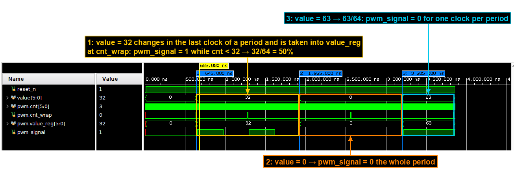

## Lint, synthesis, implementation

* **Lint**: linter on `chip_top` with all sub-modules – 0 violations.
* **Elaborated design**: DRC and methodology clean. RTL schematic of `chip_top` in `results/2_lint_and_rtl/`.
* **Constraints**: one clock (`create_clock` on `clk`, 10 ns). The inputs are synchronized inside the design and
  the outputs are slow, so the XDC has a `set_false_path` for both.
* **Synthesis**: 0 errors, 0 critical warnings. 28 `[Synth 8-7129]`: `pkt_data` bits that `parser` doesn't read
  (the second comma, the `}` byte and the high nibble of the blue digits, which `rx_mac` already checked).
  9 `[Synth 8-3917]`: constant outputs (`dp` = 1, and the `led` bits that don't mark a field are 0).
  The `rx_mac` state machine was re-encoded one-hot.
* **Implementation** (`results/4_implementation/`): 0 errors, 0 critical warnings, 0 warnings; all 962 routable
  nets routed, DRC clean, and the methodology report has only the two SYNTH-6 warnings of the gamma table.
  Critical path: `rx_mac_i/pkt_data_reg[value_0][2][1]` → the conversion of the blue field and the `> 255` check
  in `parser` (5 CARRY4) → `parser_i/pixel_valid_reg/D`, 6.945 ns, 9 logic levels.

| Resource | Used | Available |
|---|---|---|
| Slice LUTs | 424 (439 after synthesis), 4 of them shift registers | 63 400 |
| Flip-flops | 535 (527 after synthesis, 554 in the RTL) | 126 800 |
| CARRY4 | 80 | |
| Block RAM | 2 × RAMB18 (the gamma table) | 270 |
| DSP | 0 | 240 |
| I/O | 47 (8 inputs, 39 outputs) | 210 |
| BUFG | 1 | 32 |
| Worst setup slack @ 100 MHz | 2.839 ns | |
| Worst hold slack | 0.092 ns | |
| Power (estimate) | 0.113 W | |

I counted the flip-flops from the RTL before synthesis (554) and compared them with the out-of-context run of
each module (556 together) and with the full design (527 after synthesis, 535 after placement). The differences:

1. `rx_phy` keeps its state register twice, as `FSM_sequential_state_reg` and `state_reg`, 2 bits each (+2).
2. `rx_mac` is one-hot: 4 state flip-flops instead of 2 (+2).
3. `tx_mac`: the `done` output of `binary_2_bcd` goes to `bcd_done`, which nothing reads, so its register is
   removed (−1).
4. `tx_phy`: `sh_reg[9]` is always 1 (loaded with 1, shifts in 1), so it is removed (−1).
   Together that is the +2 of the out-of-context sum.
5. Full design (−29 against the sum): the 24 `pwm_pixel` flip-flops of `selector` moved into the two RAMB18 as
   their address register, and 4 chains of the `pkt_data` shift register in `rx_mac` moved into shift-register
   LUTs, so `rx_mac` has 132 instead of 137.
6. After placement, `opt_design` copies every `an` bit to `an_reg[i]_lopt_replica`, which drives only its pin (+8).

The per-module numbers are in
[`results/5_resource_usage/per_module_out_of_context/summary.txt`](results/5_resource_usage/per_module_out_of_context/summary.txt).

## On the board

I sent the packets from CoolTerm at 57600 bps, 8N1, and CoolTerm also shows the board's reply. In the photos every
display field and LED has a coloured box and a tag, and the CoolTerm line under the board shows the packet and the
reply. Cases 1–6 are on the final bitstream (CIE normalised to red). The photo after reset and cases 7–12 are from
the previous bitstream, where CIE was normalised to blue. Those cases test the buttons, the display, the LED select
and a dropped packet, and `cie_scaling` is not on their path. Only the replies of cases 10 and 12 depend on it,
and they are marked "(to B)".

| Case | Input | Display (T3 T2 T1 T0) | RGB LED | TX reply |
|---|---|---|---|---|
| 1 | `{R255,G255,B255}` | `01 FF FF FF` | `LD16` white | `{R1023,G0518,B1023}` |
| 2 | `{R255,G000,B000}` | `01 FF 00 00` | `LD16` red | `{R1023,G0000,B0000}` |
| 3 | `{R000,G255,B000}` | `01 00 FF 00` | `LD16` green | `{R0000,G0518,B0000}` |
| 4 | `{R000,G000,B255}` | `01 00 00 FF` | `LD16` blue | `{R0000,G0000,B1023}` |
| 5 | `{R128,G128,B128}` | `01 80 80 80` | `LD16`, dimmer | `{R0221,G0111,B0221}` |
| 6 | `{r010,g020,b030}` | `01 0A 14 1E` | `LD16` dim blue | `{R0003,G0003,B0013}` |
| 7 | `{L017}`, then `{L016}` | `10 0A 14 1E`, then `01 0A 14 1E` | `LD17`, then `LD16` | none |
| 8 | `{R256,G000,B000}` | kept | unchanged | none |
| 9 | `BTNL` × 4 | cursor T0 → T3, stays on T3 | unchanged | none |
| 10 | `BTNU` on T3, then `BTNC` | `01 0A 14 1E` → `10 0A 14 1E` | `LD16` → `LD17` after `BTNC` | `{R0000,G0000,B0013}` (to B) |
| 11 | `BTNR`, `BTNU` × 3, `BTNR`, `BTND` × 3, `BTNR` | `10 0A 14 1E` → `10 0D 11 1E` | unchanged until `BTNC` | none |
| 12 | `BTNC` | `10 0D 11 1E` | `LD17` | `{R0001,G0000,B0013}` (to B) |

| | | |
|---|---|---|
| 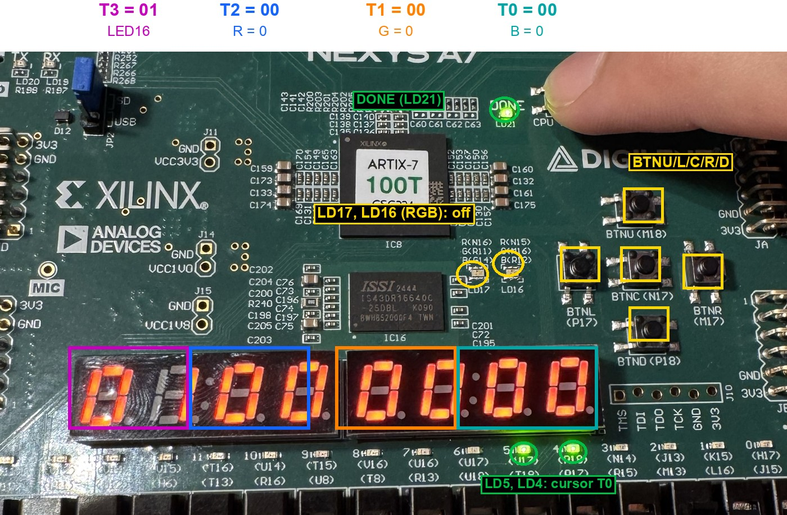 | 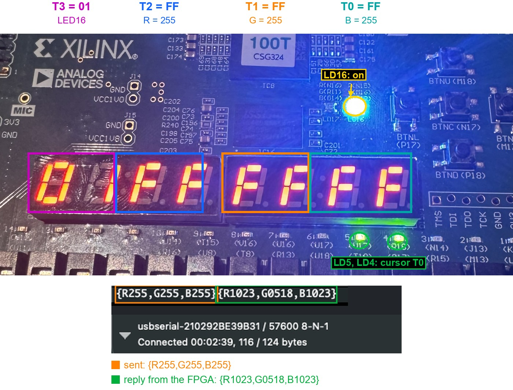 | 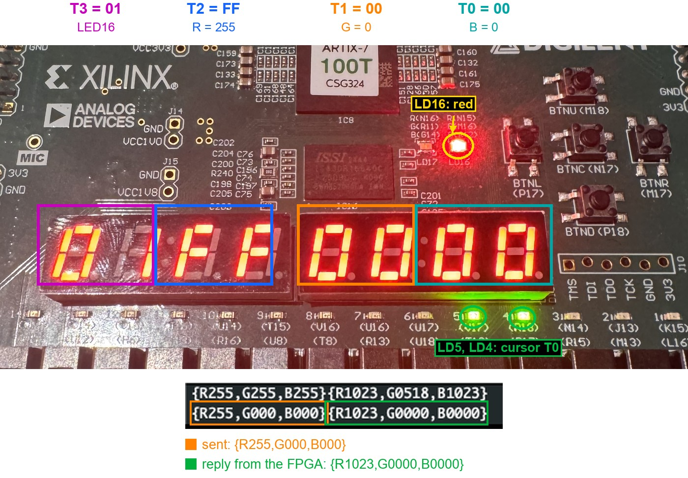 |
| after reset: `01 00 00 00`, cursor on T0 | case 1 – white | case 2 – red |
| 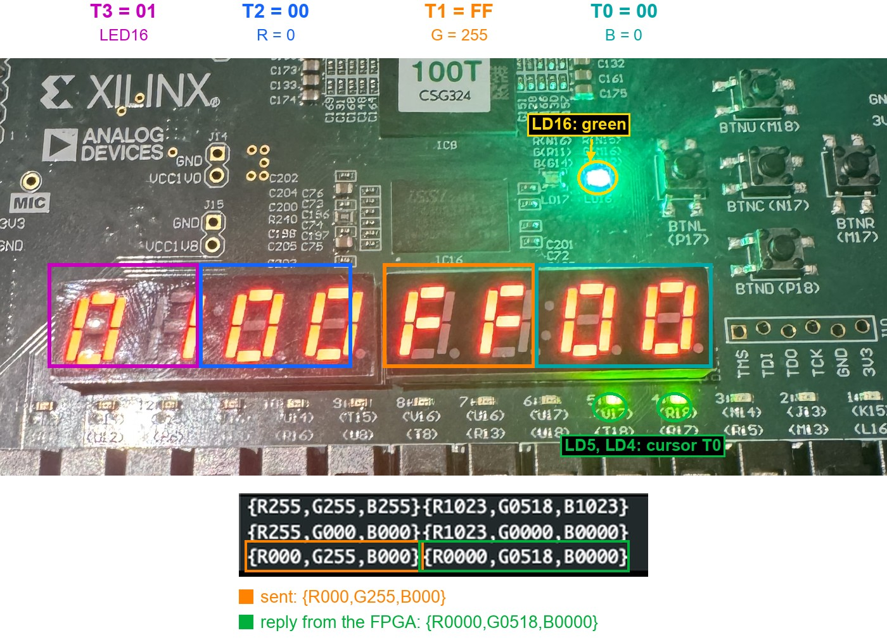 | 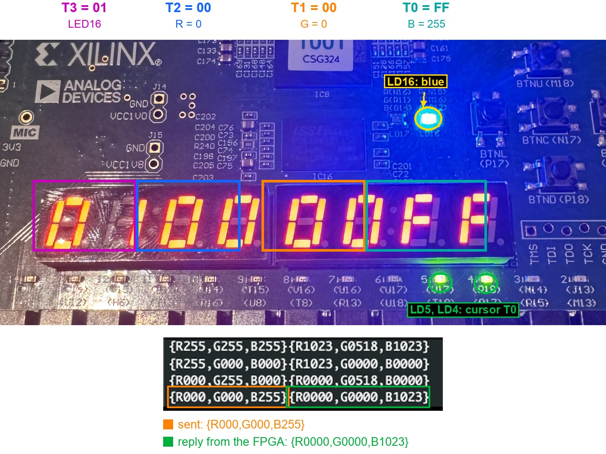 | 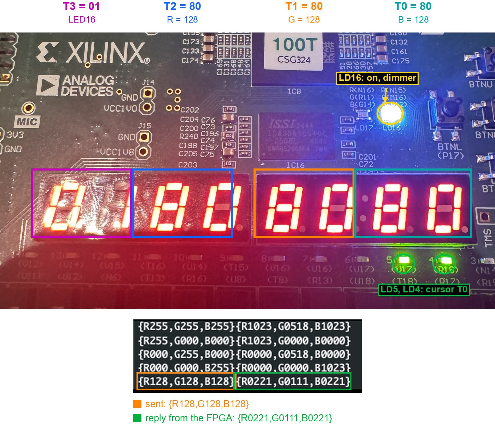 |
| case 3 – green at 518 of 1024 | case 4 – blue | case 5 – `{R128,G128,B128}` |
| 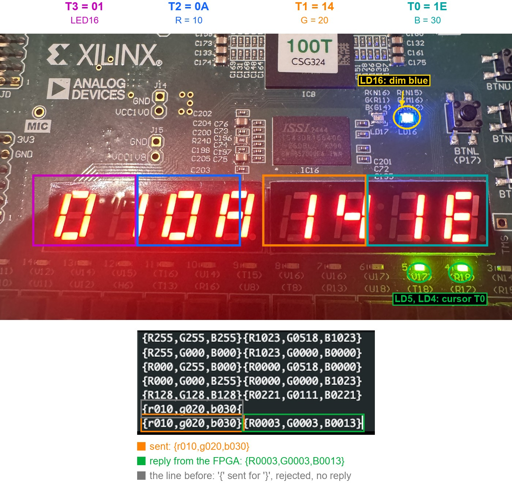 | 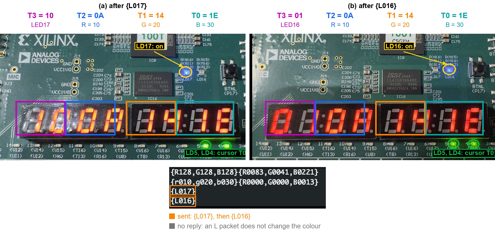 | 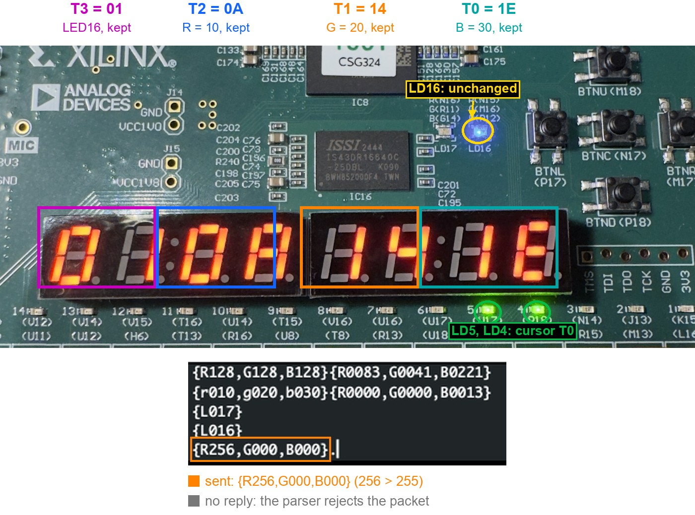 |
| case 6 – lower-case letters | case 7 – `{L017}` and `{L016}` | case 8 – 256, nothing changes |
| 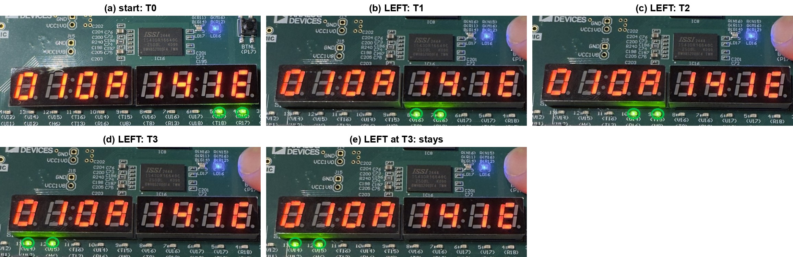 | 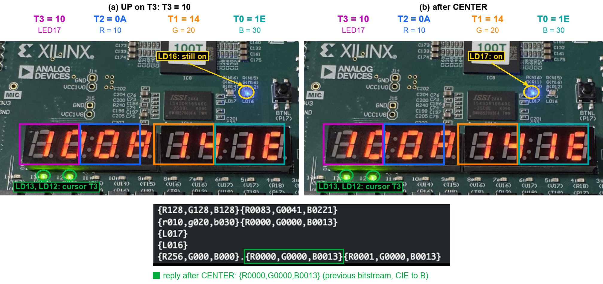 | 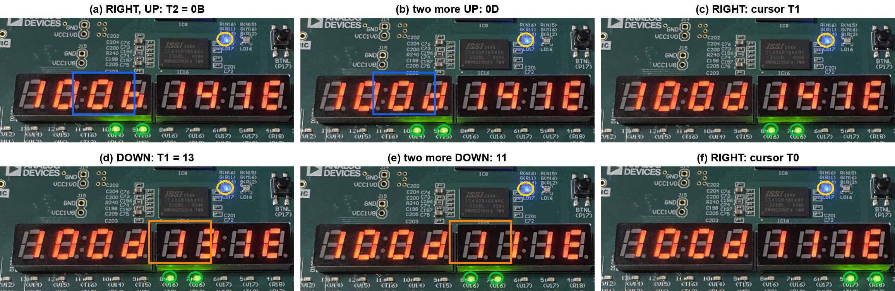 |
| case 9 – the cursor stops at T3 | case 10 – `LED17` with the buttons | case 11 – editing, the LED waits for `BTNC` |
| 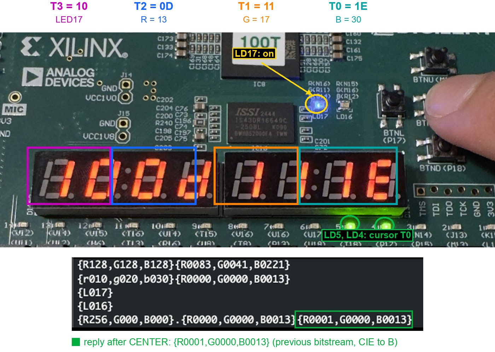 | | |
| case 12 – `BTNC` applies the edit | | |

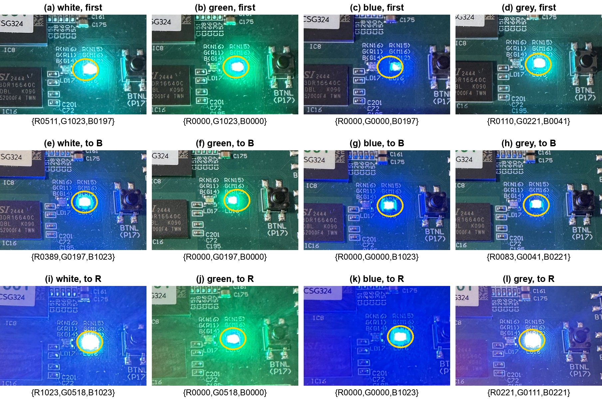

The three `cie_scaling` versions on the board, for the same four packets (white, green, blue and grey): the first
version (a–d), normalised to blue (e–h) and normalised to red, the final one (i–l). With the first version white and
grey look green, and normalised to blue they look blue. Normalised to red they are the closest to white of the three,
although Rec.601 predicts a yellowish white. The LED and the camera's white balance don't have to match the formula,
so this comparison is by eye; the reply under each photo has the real values.

Submitted report (Hebrew, with every waveform, FSM transition table, the CIE comparison and report excerpt):
[`docs/lab6_report.pdf`](docs/lab6_report.pdf).

## Files

```
rtl/          17 modules, one per file, plus lab6_pkg.sv, lab6_definitions.svh and black_magic_box.sv (the given
              gamma table)
tb/           17 testbenches, one per module
constraints/  nexys_a7_100t.xdc – CLK100MHZ, CPU_RESETN, BTNU, BTND, BTNL, BTNR, BTNC, LED[15:0], LED16 and LED17
              (R, G, B), CA..CG, DP, AN, UART_TXD_IN, UART_RXD_OUT
docs/         block diagram, the five FSM diagrams, lab6_report.pdf
results/      1_simulation  2_lint_and_rtl  3_synthesis  4_implementation  5_resource_usage
              bitstream_summary.txt
board_test/   annotated photos with the CoolTerm lines
```
