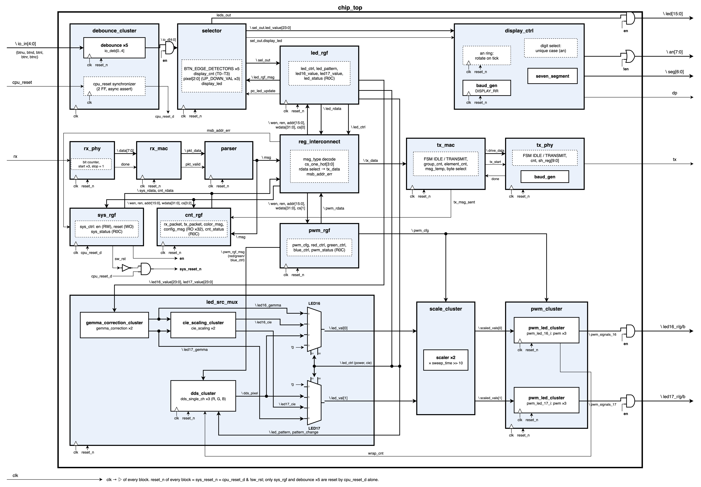
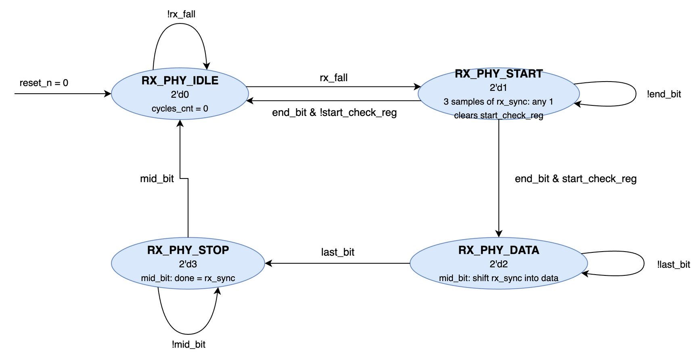
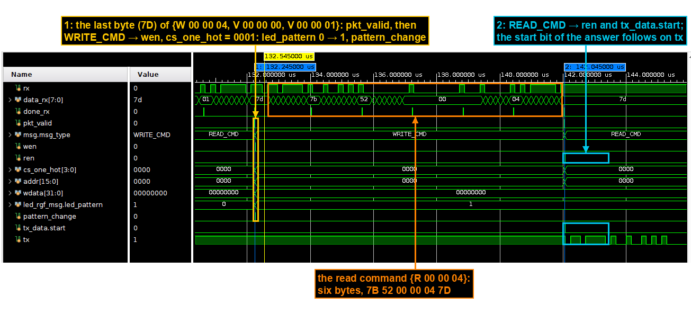
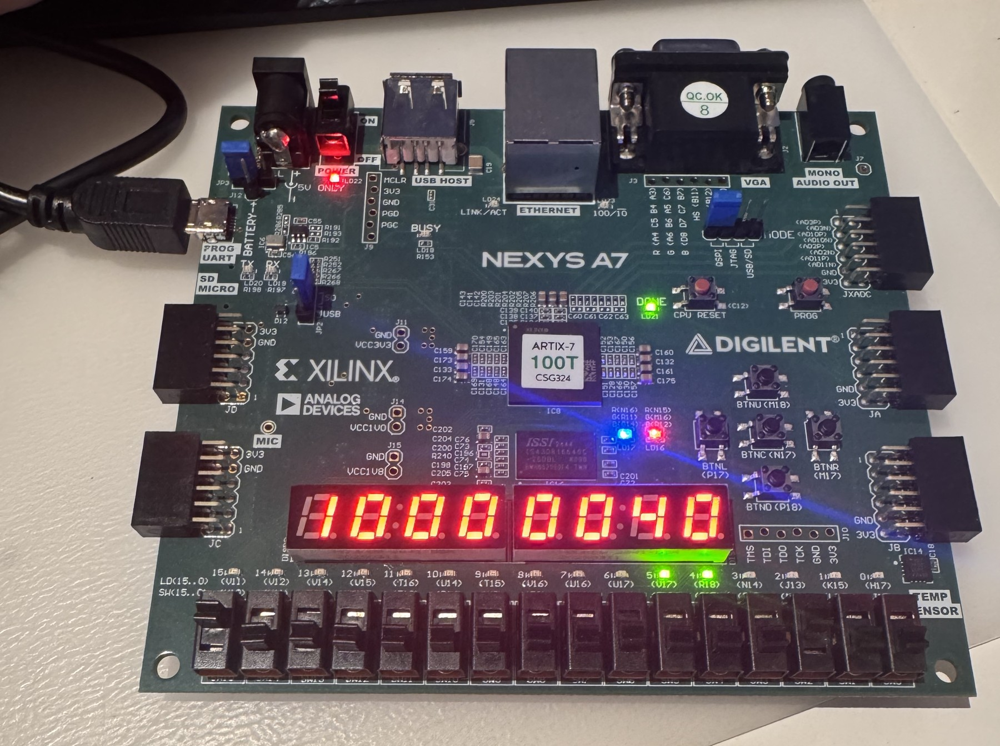
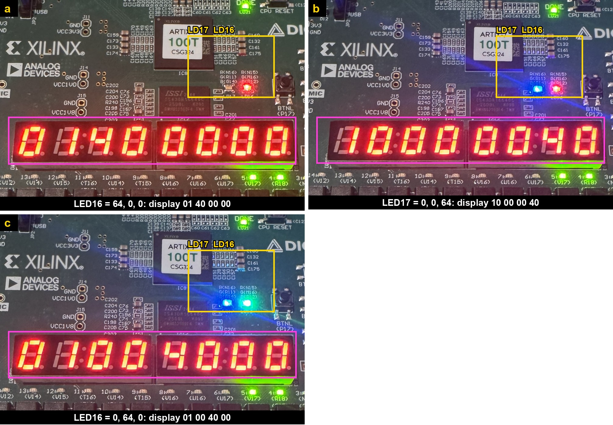
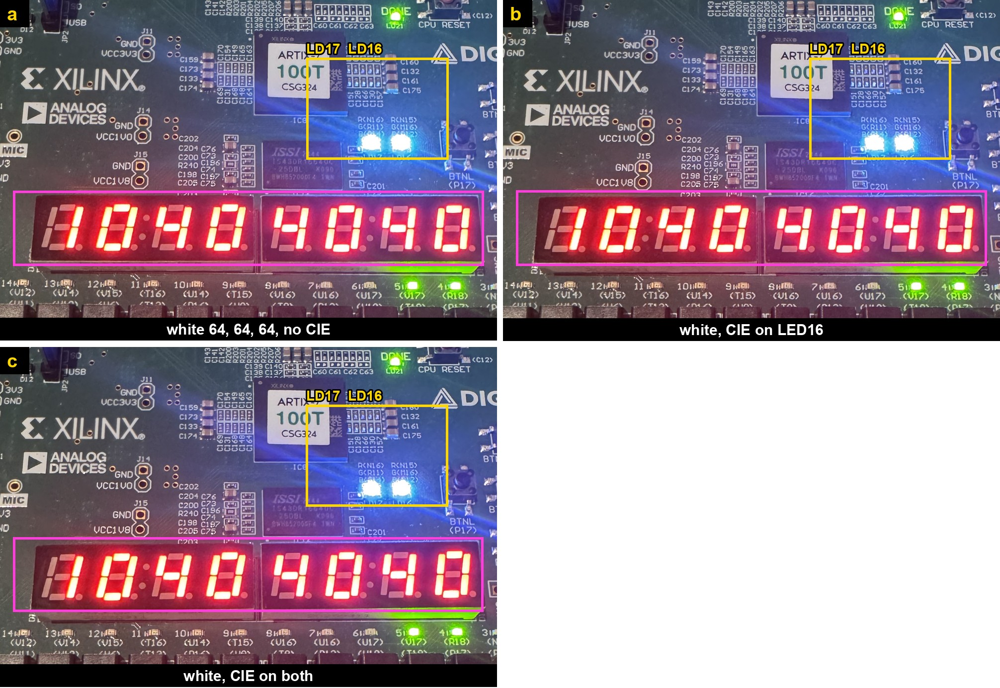
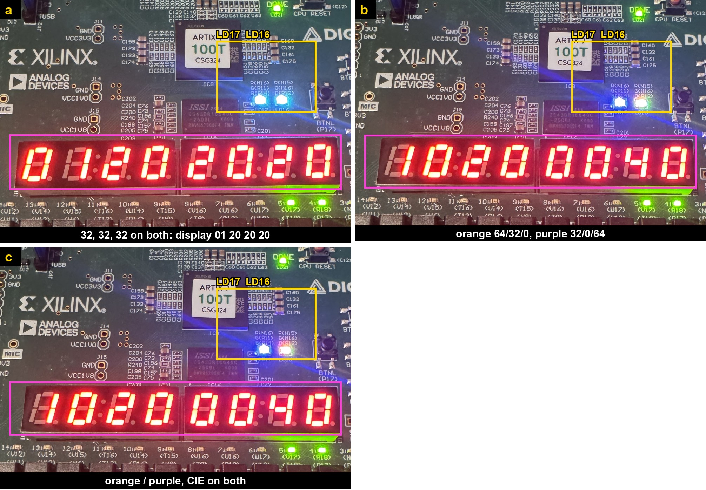
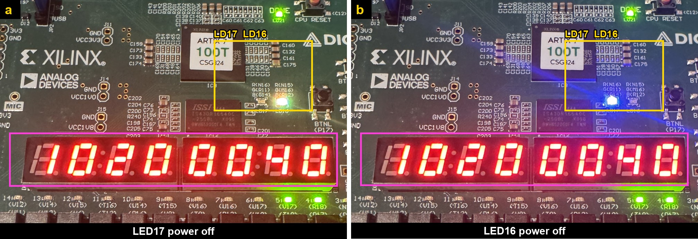
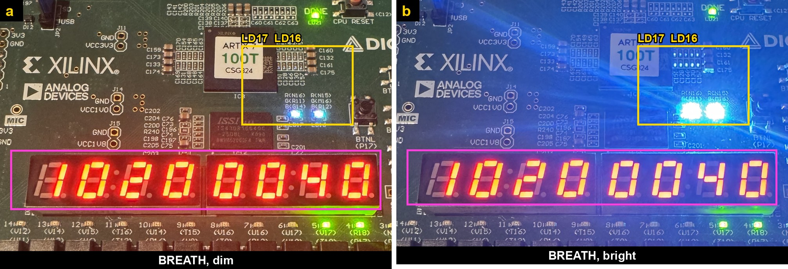
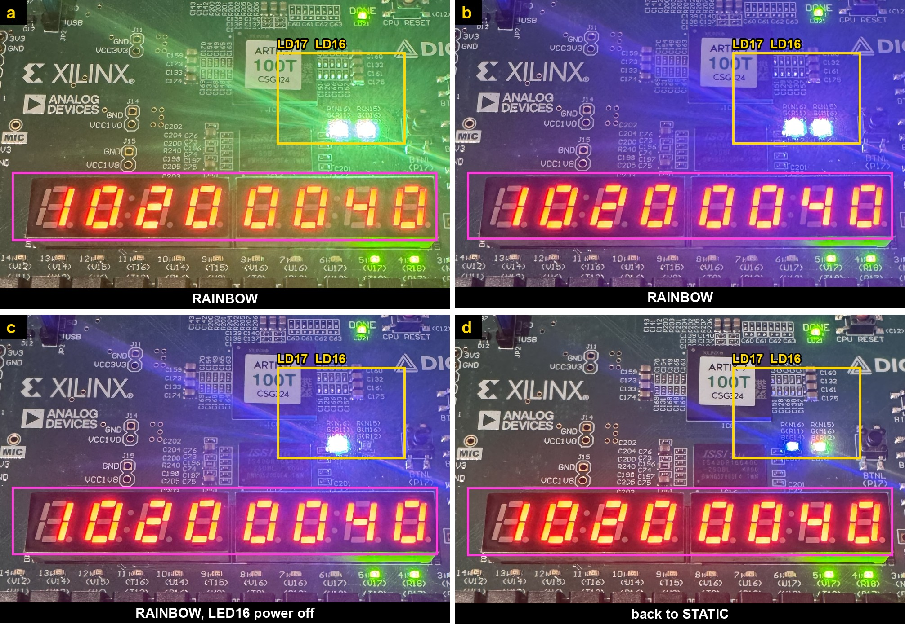

# Lab 7 – Control register files and a DDS for PWM

Lab 6's PWM controller for the two RGB LEDs (`LED16`, `LED17`), now controlled from the PC through register files.
The PC writes and reads 32-bit registers over UART, and a DDS makes light patterns from a sine table.

* **UART** (57600 bps, 8N1), five messages:
  * write: `{W<A2,A1,A0>,V<0,DH1,DH0>,V<0,DL1,DL0>}`, 16 bytes with a 24-bit address and 32-bit data in binary
  * read request: `{R<A2,A1,A0>}`, 6 bytes
  * read reply from the board: the write format with `R` in place of `W`
  * pixel `{Rddd,Gddd,Bddd}` and LED select `{L016}` / `{L017}`, as in Lab 6
* **Register files**: `A2` selects one of four, and `A1,A0` are the offset inside it.

  | `A2` | Register file | Registers (offset) |
  |---|---|---|
  | `0x00` | `led_rgf` | `led_ctrl` (0x0000): select, power and CIE per LED; `led_pattern` (0x0004): static, breath, rainbow; `led16_value` (0x0008), `led17_value` (0x000C); `led_status` (0x0010) |
  | `0x01` | `pwm_rgf` | `pwm_cfg` (0x0000): slots per period and clocks per slot; `red_pwm_ctrl`, `green_pwm_ctrl`, `blue_pwm_ctrl` (0x0004 to 0x000C): DDS step (10 to 5000), gain (x1, x2, x4, x8) and start phase; `pwm_status` (0x0010) |
  | `0x02` | `cnt_rgf` | `rx_packet`, `tx_packet`, `color_msg`, `config_msg` (0x0000 to 0x000C), read-only 32-bit counters; `cnt_status` (0x0010) |
  | `0x03` | `sys_rgf` | `sys_ctrl` (0x0000): software reset and enable; `sys_status` (0x0004) |

  Every register file has a read-to-clear status register with `addr_err`, set by an access to an offset with no
  register. An `A2` with no register file sets `msb_addr_err` in `sys_status`. The full map with fields, types and
  reset values is in [`lab7_rgf.xlsx`](lab7_rgf.xlsx), one sheet per register file.
* **Patterns**: static shows the pixel of each LED after gamma correction, with or without CIE scaling. Breath gives
  the three colours the same DDS phase, so the light is white and its brightness rises and falls. Rainbow keeps the
  three phases a third of a period apart.
* **Buttons and display**: as in Lab 6. `BTNC` now writes the edited pixel and LED to `led_rgf`.

Each of the 25 testbenches checks one module, and the design is lint-clean, synthesized, placed, routed and tested
on the board.



## Architecture

Everything runs on one 100 MHz clock. The paths are

* RX: `rx_phy → rx_mac → parser → reg_interconnect → led_rgf / pwm_rgf / cnt_rgf / sys_rgf`
* LED: `led_rgf, pwm_rgf → led_src_mux → scale_cluster → pwm_cluster`
* TX: `reg_interconnect → tx_mac → tx_phy`

`parser` gives one `msg` with a type, an address and data. `reg_interconnect` turns it into a register access:
`wen` or `ren`, `addr`, `wdata` and a one-hot `cs` for the four register files. A pixel message and an LED message
also become writes to `led_rgf`, so the values are kept in one place. On a read it picks the `rdata` of the selected
register file and gives it to `tx_mac` with the address.

`led_src_mux` picks the source of each LED: 0 when the LED is off, the DDS output in breath and rainbow, and in
static the pixel after gamma, with or without CIE. `sys_rgf` gives `sw_rst` and `en`. The reset of every module,
`sys_reset_n`, goes low when `cpu_reset_d` goes low or `sw_rst` goes high. `en` = 0 turns off the buttons and the
`led`, `an` and RGB outputs, and the control path keeps working.

All the source files are in [`lab7.srcs/sources_1/new/`](lab7.srcs/sources_1/new/).

| Module | Function | Flip-flops (RTL) |
|---|---|---|
| `chip_top` | instantiates everything, makes `sys_reset_n` and gates the outputs with `en` | 0 |
| `lab7_pkg`, `led_rgf_pkg`, `pwm_rgf_pkg`, `cnt_rgf_pkg`, `sys_rgf_pkg` | widths, ASCII constants, the message structs, the FSM enums, and per register file its addresses and register structs | – |
| `lab7_definitions.svh` | the three hardware values, with short ones when `SIM` is defined | – |
| `debounce_cluster` | 5 `debounce` instances (`generate`) and the `CPU_RESETN` branch: asynchronous assert, release through 2 flip-flops | 127 |
| `debounce` | 2-FF synchronizer + FSM with a 20 ms stability counter | 25 each |
| `rx_phy` | one counter of the clocks inside a bit (0 to 1735); the start bit is checked at 3 points, every bit is sampled at count 868, and `done` rises only if the stop bit is 1 | 29 |
| `rx_mac` | message FSM: checks the structure byte by byte (`{`, letter, three value bytes, `,`, `}`, at most three groups) and shifts each byte into a 128-bit register | 135 |
| `parser` | checks the letters of each message type and the content of the value bytes, gives `msg` with the type, the 24-bit address and the data | 75 |
| `reg_interconnect` | `msg` → `wen` / `ren`, `addr`, `wdata`, one-hot `cs`; the read mux to `tx_mac`; `msb_addr_err` | 0 |
| `led_rgf` | `led_ctrl`, `led_pattern`, `led16_value`, `led17_value`, `led_status`; also written by `BTNC`, and the buttons have priority | 60 |
| `pwm_rgf` | `pwm_cfg`, the three DDS registers, `pwm_status`; a write of 0 slots or 0 clocks per slot is dropped | 105 |
| `cnt_rgf` | four 32-bit message counters, `cnt_status` | 129 |
| `sys_rgf` | `en`, the one-clock `sw_rst` pulse, `sys_status` | 4 |
| `selector` | edge detector per button, the cursor, the display copy of the pixel and the LED | 32 |
| `display_ctrl` (+ `baud_gen`, `seven_segment`) | 8-bit anode ring on a 4 kHz tick, hex digit → 7 cathodes | 23 |
| `led_src_mux` | source select per LED; holds `gemma_correction_cluster`, `cie_scaling_cluster` and `dds_cluster` | 51 |
| `gemma_correction` ×2, `cie_scaling` ×2 | the given 256 × 10-bit gamma table (`black_magic_box.sv`) and the Rec.601 green weight, one pair per LED | 0 |
| `dds_cluster`, `dds_single_ch` ×3 | 17-bit phase accumulator per colour; the top 9 bits index the 512-entry sine table (`sin_wave_table.sv`) | 17 each |
| `scale_cluster`, `scaler` ×2 | 10-bit value × `sweep_time` >> 10, six multipliers | 0 |
| `pwm_cluster`, `pwm_led_cluster` ×2, `pwm` ×6 | per channel a slot counter and a period counter (16 bits each), a 16-bit value register and `pwm_signal` | 294 |
| `tx_mac` | FSM that sends the 16 bytes of a read reply; a start in the middle of a reply is ignored | 79 |
| `tx_phy` (+ `baud_gen`) | bit-level 8N1 transmitter | 26 |

The flip-flop column is what I counted in the RTL before synthesis, each module together with its sub-modules.
The top-level rows add up to 1169.

State diagrams of the five state machines:
[`fsm_debounce`](docs/fsm_debounce.png), [`fsm_rx_phy`](docs/fsm_rx_phy.png), [`fsm_rx_mac`](docs/fsm_rx_mac.png),
[`fsm_tx_mac`](docs/fsm_tx_mac.png), [`fsm_tx_phy`](docs/fsm_tx_phy.png). The register files, `reg_interconnect`,
the DDS and the PWM are counters and combinational decode, with no state machine.



`lab7_definitions.svh` holds the hardware values, with short ones for the simulation (`SIM` defined):

| Define | Hardware | `SIM` | Meaning |
|---|---|---|---|
| `BAUD_RATE` | 57 600 | 6 250 000 | UART bit rate (16 clocks per bit in simulation) |
| `DEB_COUNT` | 2 000 000 | 10 | clocks an input must be stable (20 ms) |
| `DISPLAY_RR` | 4 000 | 10 000 000 | display scan tick rate |

Design notes that came up while doing it:

* PWM window: one counter counts `time_slots` clocks per slot and a second one counts `sweep_time` slots. With the
  reset values, 1024 · 1 · 10 ns = 10.24 μs, 97.66 kHz.
* `scaler` fits the 10-bit table value to the number of slots with a multiply and a shift, no divider:
  `val · sweep_time >> 10`. Value 1023 with 1024 slots stays 1023.
* DDS: the low 8 bits of the accumulator are a fraction. `freq` is added at the end of every PWM period, so one wave
  takes 512 · 256 / `freq` PWM periods. On the board I used `freq` = 10 and `time_slots` = 15:
  13107.2 · 1024 · 15 · 10 ns = 2.01 s for one breath.
* Rainbow phases: 512 / 3 ≈ 171 for green and 2 · 512 / 3 ≈ 341 for blue.
* `rx_phy` sampling error. A real bit is 100 000 000 / 57 600 = 1736.11 clocks, and the counter restarts only on
  the falling edge of the start bit, so the error adds up until the stop bit, 9.5 bits later:
  1. Labs 5 and 6: a 108-clock counter gave 16 ticks per bit, a bit of 1728 clocks. 8.11 clocks per bit,
     77 clocks at the stop bit, 4.4 % of a bit.
  2. Now: one counter from 0 to 1735. 0.11 clocks per bit, 1.06 clocks at the stop bit, 0.06 % of a bit.

  The margin is half a bit, 868 clocks, so the old error did not give a wrong sample. The new structure has the same
  11 flip-flops for the counter.
* Unused bits of a 32-bit register: only the defined fields have flip-flops, and the read path fills the rest with
  zeros. `led_rgf` has 56 flip-flops for its four RW registers instead of 128.
* `sys_ctrl.reset` is a write-only command that gives a one-clock pulse. As an RW level the PC would raise it and
  the second message, the one that lowers it, would never be received.
* `sys_ctrl.en` turns off only the buttons and the outputs. If it also stopped the receiver, nobody could write
  `en` = 1 again, and only `CPU_RESETN` would bring the board back. That is why `rx_phy` has no `en` input.
* PWM counters: every `pwm` has its own two 16-bit counters, 192 flip-flops of counters for six channels that all
  count the same thing. One shared pair would save 160 flip-flops, 15 % of the design. I kept it this way because
  `pwm` stays a whole module with its own testbench.
* The gamma and sine tables are combinational, in LUTs: 699 LUTs in `led_src_mux`, about 1 % of the device, and the
  value is ready in the same clock. Block RAM would add a clock of delay per table.
* Bugs:
  1. `rx_phy` never checked the stop bit: `done` rose in the middle of it without sampling the line, so a frame
     with a framing error was accepted as a good byte. The bug came from Labs 5 and 6, and the reviewer of the Lab 5
     report found it. Now `done` rises only if `rx_sync` is 1 in the middle of the stop bit.
  2. `sys_rgf`: both branches of the address `case` were `SYS_CTRL_ADDR`, so `sys_status` could not be read.
     `tb_sys_rgf` failed on it in four checks and `tb_chip_top` in one, and synthesis reported it as `Synth 8-151`
     and `Synth 8-6014`.
  3. `tb_rx_phy` stopped compiling after the `en` port was removed from `rx_phy`. A change to a module's interface
     has to come with its testbench in the same commit.
* Known limits: a frame with a bad stop bit is dropped with no error flag, and there is no timeout between bytes,
  so a message that was cut stays open until the next `{`.

## Verification

Every testbench checks its DUT with immediate `assert`s and SVA properties, and a failed check prints an `Error`
line in the xsim log. All 25 logs end without one (126 immediate assertions and 20 SVA properties).
`tb_seven_segment` has no assertions, so I checked it in the waveforms. The cluster modules that only repeat another
module are checked through the module that holds them. For every testbench the report also has one deliberate break
of the DUT that shows the checks fail when the code is wrong.
Results summary: [`results/1_simulation/simulation_summary.txt`](results/1_simulation/simulation_summary.txt),
xsim logs in `results/1_simulation/simulation_logs/`, the annotated waveforms and their wave configs next to them.
The testbenches are in [`lab7.srcs/sim_1/new/`](lab7.srcs/sim_1/new/).

| Testbench | DUT | Assertions (immediate + SVA) | What the waveforms show |
|---|---|---|---|
| `tb_debounce` | `debounce` | 11 + 1 | a stable change, short pulses, reset |
| `tb_debounce_cluster` | `debounce_cluster` (5 × `debounce`) | 3 + 2 | one button at a time, reset and short pulses |
| `tb_rx_phy` | `rx_phy` | 6 + 2 | receiving `0xA5`; a frame with stop bit 0, then a low pulse of a quarter bit |
| `tb_rx_mac` | `rx_mac` | 2 + 0 | a pixel message, a write and a read request; a message with no comma is dropped; a `{` in the middle of a message and a fourth group |
| `tb_parser` | `parser` | 3 + 0 | the four message types, three invalid messages and lower-case letters |
| `tb_reg_interconnect` | `reg_interconnect` | 7 + 0 | an invalid message, a write, a read, pixel and LED messages, an address with no register file |
| `tb_led_rgf` | `led_rgf` | 17 + 4 | write and read, rejected values, a `BTNC` press, a pattern change and `led_status` |
| `tb_pwm_rgf` | `pwm_rgf` | 12 + 2 | write and read, a rejected 0 and an offset with no register |
| `tb_cnt_rgf` | `cnt_rgf` | 3 + 0 | counting the messages by type, `cnt_status` and reset |
| `tb_sys_rgf` | `sys_rgf` | 5 + 0 | `en`, the `sw_rst` pulse and a read of `sys_status` |
| `tb_selector` | `selector` | 11 + 0 | loading from `led_rgf`, editing with the buttons and `BTNC`; the value limits, a held button and an LED select from the PC |
| `tb_display_ctrl` | `display_ctrl` (+ `baud_gen`, `seven_segment`) | 4 + 0 | one scan of the eight digits with `LED16` and with `LED17` |
| `tb_seven_segment` | `seven_segment` | 0 + 0 | digits 0 to 9; letters A to F |
| `tb_gemma_correction` | `gemma_correction` | 3 + 0 | the low and the high red values; the end of the green loop and the start of the blue one |
| `tb_cie_scailing` | `cie_scaling` | 1 + 0 | the high values, and five pixels with a different value per channel |
| `tb_dds_single_ch` | `dds_single_ch` | 3 + 4 | a step, a phase load, the gain and five configurations |
| `tb_dds_cluster` | `dds_cluster` (3 × `dds_single_ch`) | 4 + 0 | breath and the start of rainbow; every channel with its own phase and step |
| `tb_led_src_mux` | `led_src_mux` (+ the gamma, CIE and DDS clusters) | 7 + 0 | power, CIE and the patterns, with a different value per LED |
| `tb_scaler` | `scaler` | 1 + 0 | three values of `sweep_time` |
| `tb_pwm` | `pwm` | 2 + 0 | a PWM period and a new value that enters at its end; the slot shortened from 4 to 2 clocks; `sweep_time` from 20 to 5 |
| `tb_pwm_cluster` | `pwm_cluster` (2 × `pwm_led_cluster`, 6 × `pwm`) | 3 + 0 | one period with a different value on each of the six channels |
| `tb_tx_mac` | `tx_mac` | 3 + 0 | one 16-byte read reply; a start in the middle of a reply does not change it |
| `tb_tx_phy` | `tx_phy` (+ `baud_gen`) | 4 + 2 | the frame of `0xA5` |
| `tb_baud_gen` | `baud_gen` | 6 + 3 | a full count, `en` = 0 in the middle, reset |
| `tb_chip_top` | full system (`SIM` values) | 5 + 0 | one byte in `rx_phy` with the start and stop bit checks; the end of a write to `led_pattern` and the read request after it; `en` = 0 turns the outputs off and the control path still answers; the software reset pulse |
| **total** | | **126 + 20** | |



## Lint, synthesis, implementation

* **Lint**: linter on `chip_top` with all sub-modules – 0 violations.
* **Elaborated design**: DRC clean. The methodology report has 9 RMIR-1 advisories: the inputs of the six
  multipliers in `scaler` come from registers with an asynchronous reset, so they can't be absorbed into the DSP
  block. RTL schematic of `chip_top` in `results/2_lint_and_rtl/`.
* **Constraints**: one clock (`create_clock` on `clk`, 10 ns). The inputs are synchronized inside the design and
  the outputs are slow, so the XDC has a `set_false_path` for both.
* **Synthesis**: 0 errors, 0 critical warnings, 182 warnings. 155 `[Synth 8-7129]`: fields of a struct that a
  module gets whole and reads only in part (for example the 30 high bits of `wdata` in `sys_rgf`, which keeps only
  two bits). 25 `[Synth 8-7137]` on the five `btn_prev` flip-flops of `selector`; in the implemented design they are
  FDCE, with a clear only. 2 `[Synth 8-6014]`: the two high data bytes of `msg_temp` in `tx_mac`, which are never
  sent. The methodology report has 96 DPIR-1 warnings on the six DSP48E1 blocks, for the same reason as RMIR-1, and
  one LUTAR-1: the module reset `cpu_reset_d & !sw_rst` comes out of a LUT.
* **Implementation** (`results/4_implementation/`): 0 errors, 0 critical warnings, 0 warnings; all 2475 routable
  nets routed. Critical path: the DDS phase accumulator → the sine table → the mux in `led_src_mux` → the multiplier
  input in `scaler`, 6.229 ns, 6 logic levels.

| Resource | Used | Available |
|---|---|---|
| Slice LUTs | 1898 (1904 after synthesis), 0 of them shift registers | 63 400 |
| Flip-flops | 1044 (1044 after synthesis, 1169 in the RTL) | 126 800 |
| CARRY4 | 240 | |
| Block RAM | 0 | 135 |
| DSP | 6 (the multipliers in `scaler`) | 240 |
| I/O | 47 (8 inputs, 39 outputs) | 210 |
| BUFG | 1 | 32 |
| Worst setup slack @ 100 MHz | 0.254 ns | |
| Worst hold slack | 0.148 ns | |
| Power (estimate) | 0.115 W | |

I counted the flip-flops from the RTL before synthesis (1169) and compared them with the out-of-context run of each
module (1140 together) and with the full design (1044 after synthesis and after placement). The differences:

1. `rx_phy` keeps its state register twice, as `FSM_sequential_state_reg` and `state_reg`, 2 bits each (+2).
2. `rx_mac` is one-hot: 4 state flip-flops instead of 2 (+2).
3. `parser`: the two high bytes of the 48-bit data field are 0 in every message type, so they become a constant
   (−16).
4. `tx_mac`: the two high data bytes of `msg_temp` are never sent, so they are removed (−16).
5. `tx_phy`: the top bit of `sh_reg` is always 1, so it is removed (−1). Together that is the −29 of the
   out-of-context sum.
6. Full design (−96 against the sum): in `pwm_cluster` the six 16-bit `val_reg` registers moved into the `P`
   output register of the six DSP48E1 blocks, and six flip-flops were added at the `chip_top` level, so it has 198
   instead of 294. In `tx_mac` six bits of the top address byte are constant 0, because a reply starts only when
   `A2` is below 4, so it has 57 instead of 63.

The per-module numbers are in
[`results/5_resource_usage/per_module_out_of_context/summary.txt`](results/5_resource_usage/per_module_out_of_context/summary.txt).

## On the board

I sent the messages from the PC with `uart_demo.py`, in a fixed order. After every write it reads the register back
and compares it with the value it wrote, and the run ended with 0 problems. The static colours were sent at 25 % of
the full value (64 in place of 255, 32 in place of 128), so the LEDs don't saturate the camera. The display shows
the selected LED (`01` = `LED16`, `10` = `LED17`) and its pixel in hex. The log of the run is
[`uart_demo_log.txt`](uart_demo_log.txt).

| Case | Sent from the PC | Display (T3 T2 T1 T0) | RGB LEDs |
|---|---|---|---|
| 1 | `{R064,G000,B000}` | `01 40 00 00` | `LD16` red, `LD17` off |
| 2 | `{L017}`, `{R000,G000,B064}` | `10 00 00 40` | `LD17` blue, `LD16` stays red |
| 3 | `{L016}`, `{R000,G064,B000}` | `01 00 40 00` | `LD16` green, `LD17` stays blue |
| 4 | white 64, 64, 64 on both, `LED_CTRL` = `0x0E` | `10 40 40 40` | both white |
| 5 | `LED_CTRL` = `0x1E`, then `0x3E` (CIE) | `10 40 40 40` | CIE on `LD16`, then on both |
| 6 | 32, 32, 32 on both | `01 20 20 20` | both dim white |
| 7 | orange 64 / 32 / 0, purple 32 / 0 / 64 | `10 20 00 40` | `LD16` orange, `LD17` purple; then CIE |
| 8 | `LED_CTRL` = `0x06`, then `0x0A` | `10 20 00 40` | `LD17` off, then `LD16` off |
| 9 | `LED_PATTERN` = 1 (breath) | `10 20 00 40` | both white, the brightness rises and falls |
| 10 | `LED_PATTERN` = 2 (rainbow) | `10 20 00 40` | both change colour together |
| 11 | rainbow, `LED_CTRL` = `0x0A` | `10 20 00 40` | `LD16` off, `LD17` keeps the pattern |
| 12 | `LED_PATTERN` = 0 (static) | `10 20 00 40` | orange and purple return |

At the end of the run the four counters match the log: 66 messages received (`rx_packet` = `0x42`), 11 of them
pixel messages (`color_msg` = `0x0B`), and 29 replies sent (`tx_packet` = `0x1D`).

| | | |
|---|---|---|
|  |  |  |
| the board in case 2: `DONE` on, `10 00 00 40` | cases 1–3 – a pixel message changes only the selected LED | cases 4 and 5 – white with no CIE, CIE on `LD16`, CIE on both |
|  |  |  |
| cases 6 and 7 – dim white, orange and purple, the same with CIE | case 8 – the power bits | case 9 – breath at two moments |
|  | | |
| cases 10–12 – rainbow, rainbow with `LD16` off, back to static | | |

Submitted report (Hebrew, with every waveform, the register tables, the design decisions and the log of the board
run): [`docs/lab7_report.pdf`](docs/lab7_report.pdf).

## Files

This lab is kept as a Vivado project and not in the `rtl/` `tb/` layout of the other labs.
File > Project > Open → `lab7.xpr`, part `xc7a100tcsg324-1`.

```
lab7.xpr                   project file
lab7.srcs/sources_1/new/   29 modules, one per file, the five packages, lab7_definitions.svh, black_magic_box.sv
                           (the given gamma table) and sin_wave_table.sv
lab7.srcs/sim_1/new/       25 testbenches
lab7.srcs/constrs_1/new/   NexysA7-100T_Master.xdc
docs/                      block diagram, the five FSM diagrams, lab7_report.pdf
results/                   1_simulation  2_lint_and_rtl  3_synthesis  4_implementation  5_resource_usage
                           bitstream_summary.txt
board_test/                annotated photos
lab7_rgf.xlsx              the register map, one sheet per register file
lab7_tb_split.xlsx         the list of testbenches and what each one checks
gen_sin_values.py, table_generator.py   write the sine table
uart_demo.py, uart_demo_info.txt, uart_demo_log.txt   the board demo, how to run it and the log of the run
```
